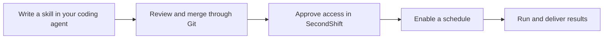

<h1>
  
  SecondShift
</h1>

[](https://github.com/piotrekno1/second-shift/actions/workflows/ci.yml?query=branch%3Amain)
[](LICENSE)

**Give recurring engineering work a shift.**

Write skills with the coding agent you already use. Commit them alongside your
code. SecondShift runs them on a schedule, with approved service access,
execution limits, and a shared history of results and costs.

Investigate CI failures every morning. Review release readiness every Friday.
Deliver a weekly report on production errors. Your team reviews the procedure
in Git and controls what each job can access.

Open source, self-hosted, and currently in beta. Use your choice of model provider.

[Try it locally](#try-it-locally) · [Deploy for your team](#use-it-with-your-team) ·
[Watch the demo](#see-it-in-action) · [Website and docs](https://second-shift.app/)

## From a developer's task to a team's recurring workflow



**Developers use their existing tools.** Author skills in Codex, Claude Code,
OpenCode, or another coding agent. Connect that agent to SecondShift
[over MCP](https://second-shift.app/docs/mcp/) to discover available service
tools, validate job configuration, and inspect jobs and reports.

**Workspace owners and admins use the dashboard.** Owners configure model
providers and service connections and approve each job's requested access.
Admins set run limits, enable schedules, and follow execution history.

**SecondShift executes the scheduled work.** Each run uses SecondShift's
execution agent and an isolated sandbox. External service calls pass through
the job's approved connections. Runs record the Git revision, tool activity,
report, and model cost.

## Run it for yourself or your team

**On your computer:** install SecondShift locally, connect a model, and schedule
skills from local repositories. You author the skills and manage their access.

**On your server:** provide a shared installation where contributors propose
skills through Git, owners approve service access, and admins manage scheduled
jobs.

A committed skill requests capabilities; it cannot grant itself credentials or
expand its approved access. Changes that request additional capabilities require
renewed approval.

Follow [Put your first skill on duty](https://second-shift.app/docs/first-scheduled-skill/)
for a walkthrough with your coding agent, a small example repository, and your
first scheduled documentation review.

## Why use SecondShift?

| Your team's problem | How SecondShift helps |
| --- | --- |
| Checks get skipped when nobody remembers to run them. | Schedule a procedure stored alongside your code. |
| Automation lives in one person's setup. | Share jobs, schedules, and run history with the team. |
| Agents need access to company services. | Owners approve each job's tools. Broader access requires renewed approval. |
| Agent usage needs limits and visibility. | Set per-run token limits and inspect usage and model cost. |
| You need to understand what happened. | Inspect the Git revision, tool activity, and report for each run. |

An existing scheduler can start an agent on a timer. SecondShift adds access
approvals, per-run limits, sandbox execution, shared run history, and cost
tracking across repositories.
[Compare SecondShift with other tools](https://second-shift.app/docs/comparisons/).

## See it in action

Follow an infrastructure review from versioned instructions and approved tools
to a report delivered in Slack. Inspect job history, run limits, tool activity,
and model cost.

https://github.com/user-attachments/assets/0a9a7baa-f79e-4934-af81-8e5374e9cdbf

## Access, budgets, and credentials

- **Access:** Workspace owners approve each job's tools. Broader access requires
  renewed approval. See [roles and permissions](https://second-shift.app/docs/self-hosting/#who-controls-what).
- **Budgets:** Set per-run token and execution limits. Each run records usage and
  model cost. See [run limits](https://second-shift.app/docs/self-hosting/#run-limits).
- **Credentials:** Your installation stores them encrypted and uses them outside
  the sandbox. Configured credentials are not passed to the model or sandbox.
  The server operator has access to them. Your model provider receives the context
  sent to it. See the [security model](https://second-shift.app/docs/security-model/).

## Try it locally

Run the included documentation review on this repository and inspect its report
and cost.

You need [uv](https://docs.astral.sh/uv/getting-started/installation/), Docker,
Git, and a model provider. Model usage may incur charges. Start Docker, then run:

```bash
# Install SecondShift
release=https://github.com/piotrekno1/second-shift/releases
uv tool install --force --python 3.13 \
  "$release/download/v0.1.0b4/secondshift-0.1.0b4-py3-none-any.whl"

# Start SecondShift
secondshift up
```

Open the sign-in link printed in the terminal.
[Local sign-in and upgrade details](https://second-shift.app/docs/self-hosting/#local-trial).

In another terminal, clone this repository:

```bash
git clone https://github.com/piotrekno1/second-shift.git
```

1. In **Connections**, add a model provider and choose a default model.
2. In **Repositories**, choose **Add local repository** and select the cloned
   directory, or enter its absolute path.
3. Open **Documentation drift** in **Jobs** and click **Run now**.
4. Inspect the report, execution timeline, and model cost.

The repository already includes the skill and configuration.

## Use it with your team

For a shared installation on a Linux server, follow the
[Docker Compose deployment guide](https://second-shift.app/docs/production-deployment/). It covers HTTPS,
GitHub App configuration, backups, and updates.

A **skill** is the written procedure the agent follows. Commit it and its
schedule to Git so your team can review changes before they take effect.

Choose a task from the [skill catalog](examples/README.md), then follow the
[task setup guide](https://second-shift.app/docs/engineering-tasks/) to approve access, test a run, and
turn on scheduling. Tasks can report findings or update connected services
through approved tools.

## Use it from your coding agent

SecondShift serves an MCP server at `/mcp`. Create a token under
**API tokens** in the account menu and paste the setup command it shows. Your
agent can then read runs and reports, start approved jobs, and check a
`.secondshift.yaml` before you commit it. It cannot approve access or see
credentials. See the [MCP guide](https://second-shift.app/docs/mcp/).

## Documentation

The full guide is at [second-shift.app/docs](https://second-shift.app/docs/overview/).

- [Comparisons](https://second-shift.app/docs/comparisons/): when to choose SecondShift, Grok Bot, Hermes Agent, or Viktor.
- [Repository configuration](https://second-shift.app/docs/repository-configuration/): skills, YAML syntax, schedules, and notifications.
- [Engineering tasks](https://second-shift.app/docs/engineering-tasks/): skill setup, approved service actions, and scheduling.
- [Environment variables](https://second-shift.app/docs/environment-variables/): service-scoped configuration and setup file generation.
- [MCP server](https://second-shift.app/docs/mcp/): connect coding agents, API tokens, and the tools they can use.
- [Architecture](https://second-shift.app/docs/architecture/): execution design and capability boundaries.
- [Security model](https://second-shift.app/docs/security-model/): what a run can reach, where secrets live, and remaining risks.
- [Self-hosting](https://second-shift.app/docs/self-hosting/) (work in progress): runner backends, sandbox images, and artifact storage.
- [Contributing](CONTRIBUTING.md): source setup, development, verification, and releases.

## Contributing

See [CONTRIBUTING.md](CONTRIBUTING.md) for bug reports, documentation changes, and
pull requests. For larger changes,
[open an issue](https://github.com/piotrekno1/second-shift/issues) first to discuss
the approach.
