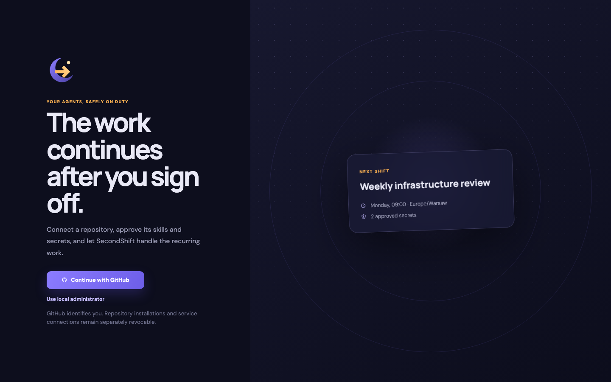
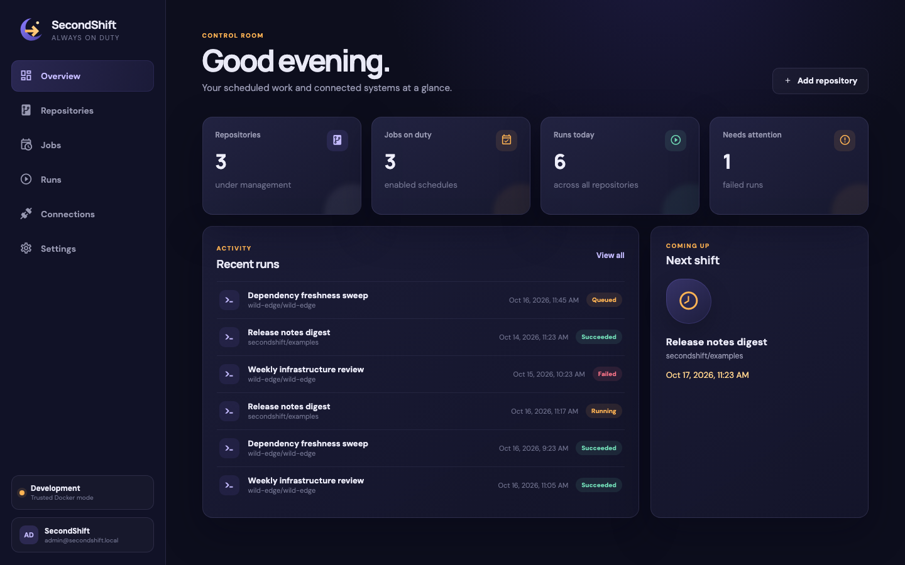
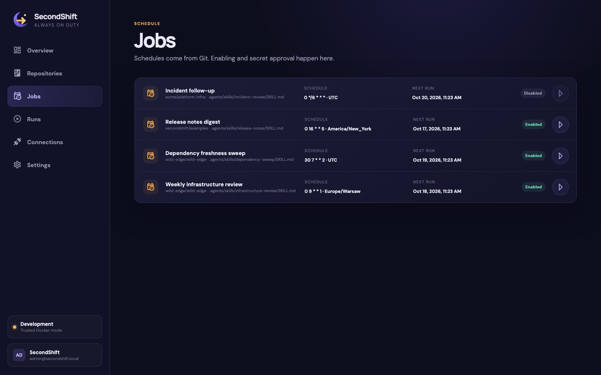
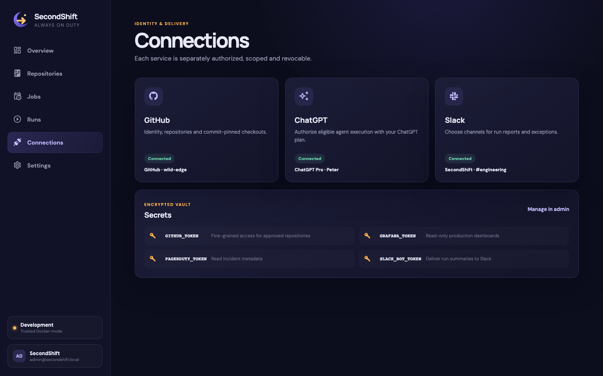
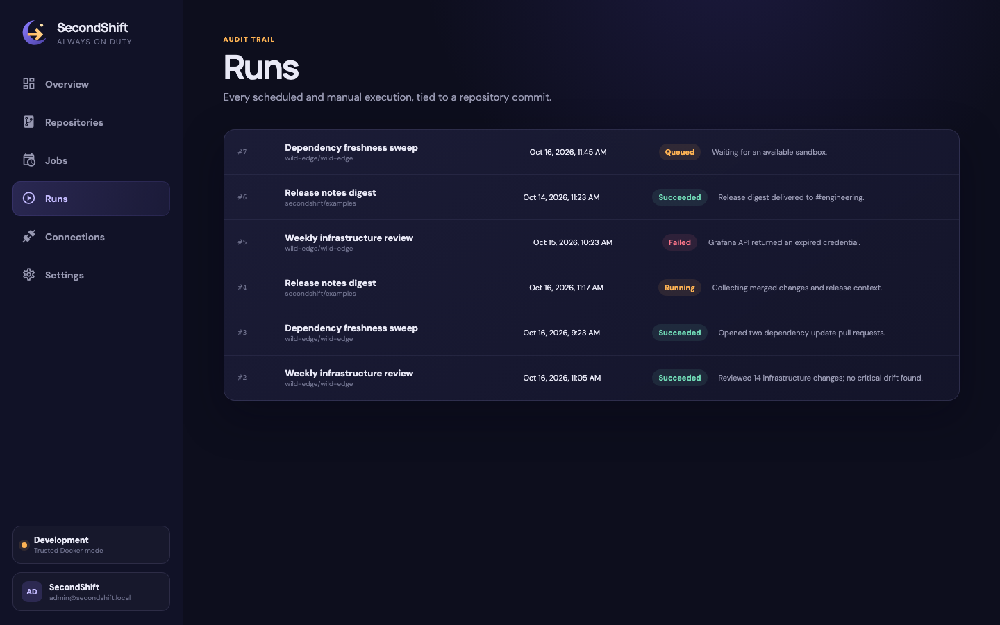

# SecondShift

**GitOps for recurring agent work.**

SecondShift runs versioned agent skills on a schedule. Commit a skill beside
your code, connect a model, approve the services it may use, and get an audited
result tied to an exact repository revision.

A root-level `.secondshift.yaml` says **what** to run and **when**. The server
controls **how** it runs, including credentials, models, sandboxes and network
access.

```yaml
version: 1
jobs:
  infrastructure-review:
    name: Infrastructure review
    skill: .agents/skills/infrastructure-review/SKILL.md
    schedule: "0 9 * * 1"
    timezone: Europe/Warsaw
    requires:
      mcps:
        - binding: observability
          tools:
            - search_dashboards
            - query_metrics
          required: true
    notify:
      - binding: engineering-alerts
```

Here, `observability` is a logical name. The workspace maps it to a real
connection and approves the requested tools. Expanding the request requires a
new approval.

## Install

Install [uv](https://docs.astral.sh/uv/getting-started/installation/) and start Docker,
then run:

```bash
uv tool install --python 3.13 \
  https://github.com/piotrekno1/second-shift/releases/download/v0.1.0a1/secondshift-0.1.0a1-py3-none-any.whl
secondshift up
```

Your browser opens with a one-time sign-in link. uv downloads Python 3.13 if
needed. No Node.js or repository checkout is required. Press Ctrl+C to stop.

SecondShift is in alpha, distributed through
[GitHub Releases](https://github.com/piotrekno1/second-shift/releases) until it is
available on PyPI.

## Product walkthrough

### 1. Sign in and hand over the shift

GitHub provides identity, while repository installations and service
connections remain separately scoped and revocable.



### 2. See what is on duty

The control room summarizes enabled repositories and schedules, today's runs,
failures that need attention, recent activity, and the next scheduled shift.



### 3. Review Git-backed schedules

Jobs are discovered from `.secondshift.yaml`. Owners can review their skill,
schedule, timezone, next execution, and enabled state before running them.



### 4. Connect services and approve capabilities

GitHub, ChatGPT, and Slack are authorized independently. Logical bindings map
repository intent to workspace-owned MCPs, APIs, and notification targets.



### 5. Follow the durable audit trail

Every scheduled or manual execution is tied to a repository commit and records
its state and human-readable outcome.



## How it works

Skills run in isolated sandboxes. Repository configuration declares schedules
and requested capabilities; the server controls models, credentials, and runtime
policy. Every run is tied to a Git commit.

## Documentation

- [Architecture](docs/architecture.md): execution design and capability boundaries.
- [Self-hosting](docs/self-hosting.md): runner backends, sandbox images, and artifact storage.
- [Contributing](CONTRIBUTING.md): source setup, development, verification, and releases.
