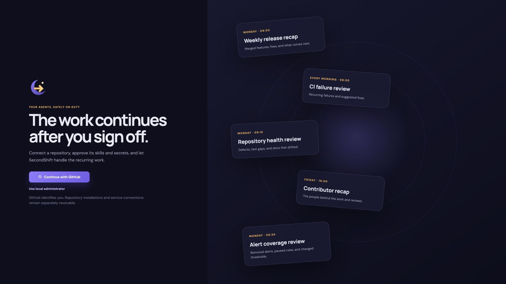

<h1>
  
  SecondShift
</h1>

[](https://github.com/piotrekno1/second-shift/actions/workflows/ci.yml?query=branch%3Amain)
[](LICENSE)

**Put an agent on your recurring engineering reviews.**

Agents investigate recurring CI failures, production errors, and gaps in
monitoring by reading your code and querying approved services. SecondShift
runs these reviews on a schedule and delivers findings backed by evidence
to your team.

<p align="center">
  <a href="https://github.com/piotrekno1/second-shift/releases/download/v0.1.0a6/secondshift-product-demo-60s-4k.mp4">
    
  </a>
  <br>
  <a href="https://github.com/piotrekno1/second-shift/releases/download/v0.1.0a6/secondshift-product-demo-60s-4k.mp4">Download the product walkthrough · 60 seconds · 4K · 22 MB</a>
</p>

Commit a skill and its schedule alongside your code, connect a model, and
approve the services it may use. Reports arrive in Slack or another webhook
destination. Commands run in an isolated sandbox. Each run records its Git
revision, tool activity, and model cost.

## Try it out now

Install [uv](https://docs.astral.sh/uv/getting-started/installation/) and start Docker,
then run:

```bash
# Install SecondShift
release=https://github.com/piotrekno1/second-shift/releases
uv tool install --force --python 3.13 \
  "$release/download/v0.1.0a6/secondshift-0.1.0a6-py3-none-any.whl"

# Start SecondShift
secondshift up
```

Upgrading from an earlier alpha? Read
[installed builds](CONTRIBUTING.md#installed-builds-and-troubleshooting) first.

Once started, the console shows:

```text
SecondShift is running at http://127.0.0.1:8000
Sign in with this link. It works once, within 15 minutes:
  http://127.0.0.1:8000/-/sign-in/<one-time-token>/
Run `secondshift login` for a new link. Press Ctrl+C to stop.
```

SecondShift is in alpha, distributed through
[GitHub Releases](https://github.com/piotrekno1/second-shift/releases) until it is
available on PyPI.

## What you can do

- **See what is on duty.** The control room shows upcoming shifts, recent runs,
  failures, and model spend.
- **Manage schedules from Git.** Discover jobs from `.secondshift.yaml`, review
  their skills and schedules, and enable or run them manually.
- **Connect models and report destinations.** Add a model provider and webhook,
  then approve each job's notification access. Connections remain separately
  revocable.
- **Give skills live data.** Connect GitHub, Sentry, any MCP server (OAuth or a
  token), or an HTTP API from its OpenAPI spec. Choose which tools jobs may use,
  then approve each job's request. Calls run outside the sandbox.
- **Follow every run.** Inspect its Git revision, execution timeline, report,
  token usage, and model cost.

## Put recurring reviews on duty

Write a skill for a recurring problem your team needs to investigate. Connect
the services it needs through MCP or an HTTP API, then approve the job's access.

| Review | What the skill can investigate | Data it needs |
| --- | --- | --- |
| [**Recurring CI failures**](.agents/skills/ci-failure-review/SKILL.md) | Which failures keep blocking builds, when they started, and which changes may explain them. | Build history and failure logs through an API or MCP connection, plus repository code. |
| [**Production errors**](.agents/skills/production-error-review/SKILL.md) | Which Sentry errors are new or worsening and which recent code changes may be related. | Issues, events, or traces through the built-in Sentry connection, plus repository code. |
| [**Monitoring coverage**](.agents/skills/monitoring-coverage-review/SKILL.md) | Whether removed alerts, paused rules, or changed thresholds leave important failure paths uncovered. | Monitoring rules and their change history through an API or MCP connection, or configuration committed to the repository. |
| [**Release readiness**](.agents/skills/release-readiness-review/SKILL.md) | Whether a planned release needs migration steps, configuration changes, or rollout instructions that are missing. | Repository changes and release plans, with an API or MCP connection for plans kept outside Git. |
| [**Incident follow-up**](.agents/skills/incident-follow-up-review/SKILL.md) | Whether completed incident action items have the promised code changes, regression tests, or monitoring. | Incident records and action items through an API or MCP connection, or documents committed to the repository. |

These are workflows you can define with skills and approved connections. Each
review depends on the data exposed by the connected service. The built-in GitHub
connection reads pull requests and commits. CI logs need a separate API or MCP
connection that exposes them.

The linked skills live in [`.agents/skills`](.agents/skills) so they can also be
used while working on SecondShift. See [Engineering tasks](docs/engineering-tasks.md)
for setup and reuse in another repository. Release readiness is included as a
manual job in this repository's manifest. Add the other jobs after choosing
their data sources and requested tools.

Ask skills to explain what changed, who is affected, why it needs attention, and
what to check next. Findings should cite their evidence and say when the
available data is insufficient to draw a conclusion.

Skills review the repository and the services you approve. Two examples to
start from:

- [Documentation drift](examples/docs-drift/README.md) finds broken links and
  stale commands in your docs. It needs only a model provider.
- [Engineering briefing](examples/engineering-briefing/README.md) summarizes the
  week from live GitHub data through an approved MCP connection.

See [Repository configuration](docs/repository-configuration.md) to add your
first skill, schedule, and webhook notification.

## Who controls what

| Role | Controls |
| --- | --- |
| **Repository contributors** | Propose skills, schedules, and requested capabilities through Git changes. |
| **Repository maintainers** | Review and merge those changes through the repository's normal process. |
| **Workspace owners** | Connect model providers and services, approve each job's access, add local repositories, and invite people and manage their roles. |
| **Workspace admins** | Enable, run and schedule approved jobs, manage repositories, and change run limits. |
| **Workspace members** | View repositories, jobs and runs. |
| **Server operators** | Define sandbox images, runtimes, resource limits, and network policy. |

Each workspace role can also do everything the roles below it can. The full
list of actions and the role each needs is `POLICY` in
`secondshift/workspaces/access.py`.

A committed skill does not grant itself access. Repository configuration cannot
choose credentials, provider endpoints, sandbox images, mounts, or network
settings. Expanding requested capabilities requires renewed approval.

Skills run in isolated sandboxes. Every run is tied to a Git commit.

## Why use SecondShift?

### How is this different from Hermes Agent?

[Hermes Agent](https://hermes-agent.nousresearch.com/docs) is individual-first,
centered on an agent that remembers your context and works across your tools.
SecondShift is team-first, built around recurring engineering tasks managed
through Git, explicit permissions, and shared run history. Both can serve
individuals or teams.

Hermes already supports scheduled skills and report delivery. In SecondShift,
review the skill and schedule in Git, approve its service access separately,
and inspect each run's revision, tool activity, report, and cost. Workspace
roles separate who can grant access, operate jobs, and view results.

A merged skill cannot grant itself credentials or expand its approved access.
Commands run in a networkless sandbox. External tool calls go through a broker
that checks the job's approved permissions. See the
[security model](docs/security-model.md) for the boundaries and remaining risks.

### Why not use an existing scheduler?

An existing scheduler can start an agent on a timer. SecondShift also handles
job discovery from Git, access approvals, sandbox execution, run history, model
cost tracking, and report delivery. It gives teams one place to manage that work
across repositories.

## Contributions welcome

SecondShift is early, and contributions are welcome: bug reports, ideas,
documentation improvements, and pull requests. See
[CONTRIBUTING.md](CONTRIBUTING.md) to get started. For larger changes,
[open an issue](https://github.com/piotrekno1/second-shift/issues) first so we can
discuss the approach.

## Documentation

- [Repository configuration](docs/repository-configuration.md): skills, YAML syntax, schedules, and notifications.
- [Engineering tasks](docs/engineering-tasks.md): review skills, required data, and setup for use in this repository or your own.
- [Architecture](docs/architecture.md): execution design and capability boundaries.
- [Security model](docs/security-model.md): what a run can reach, where secrets live, and remaining risks.
- [Self-hosting](docs/self-hosting.md) (work in progress): runner backends, sandbox images, and artifact storage.
- [Contributing](CONTRIBUTING.md): source setup, development, verification, and releases.
