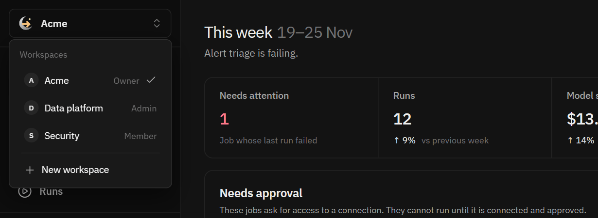
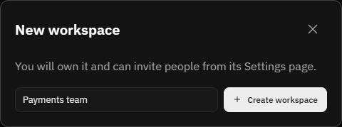
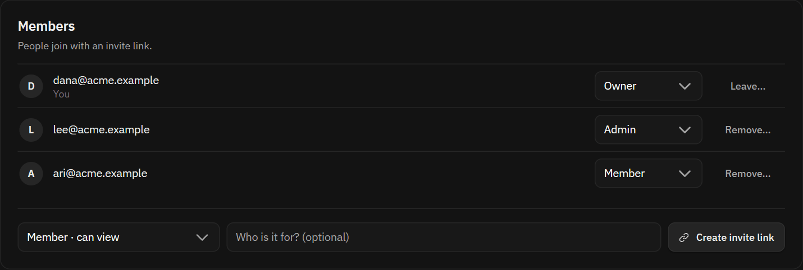

# Access

[README](../README.md) · [Control](control.md) · [Services](services.md) · [Security model](security-model.md)

A workspace is one team's setup: its repositories and jobs, the model and
services they use, the approvals and limits, and the run history. People join
a workspace with a role. A server can host several workspaces.

## Workspaces

The menu under the logo lists your workspaces and your role in each.
**New workspace** creates one with you as its owner. It appears for staff, and
for everyone when sign-up is open. See
[sign-in and the first workspace](server-configuration.md#sign-in-and-the-first-workspace).

Workspaces share nothing but the server. Adding the same repository to two of
them gives each its own jobs, approvals and history. Use one per team, or a
separate one for jobs that change data, so only its owners approve them.

The server's sandbox, [runners](runners.md) and
[limit maximums](spend.md#server-limits) apply to every workspace. Staff
accounts manage them.

## Roles

| Role | Can |
| --- | --- |
| **Owner** | Connect model providers and services, approve each job's access, set tool restrictions, invite people and change their roles. |
| **Admin** | Enable, run and schedule approved jobs, manage repositories, manage webhook triggers and change run limits. |
| **Member** | View repositories, jobs and runs. |

Owners can do everything admins can, and admins everything members can. A
workspace always keeps at least one owner, so the last owner cannot step down
or leave.

Two more parties shape what a job does, without a workspace role:

- **Repository contributors** propose skills, schedules and the access a job
  asks for, through changes to `.secondshift.yaml`. Whoever can merge decides
  what is asked for. They never decide what is granted.
- **The server operator** runs SecondShift. They choose the
  [sandbox](sandbox.md), the network policy and the
  [maximum for each run limit](spend.md#server-limits). No workspace setting
  can go past those.

The full list of actions and the role each needs is `POLICY` in
[`secondshift/workspaces/access.py`](../secondshift/workspaces/access.py).

## Invite people

Owners invite people from **Settings**. Each invite is a one-time link with a
role, and owners can change the role later. Opening a link never adds anyone by
itself: the person confirms in the dashboard while signed in. The server stores
only a hash of the link. Owners can revoke pending invites.

How people sign in, and whether anyone can sign up, is
[set on the server](server-configuration.md#sign-in-and-the-first-workspace).

## API tokens

[API tokens](mcp.md#api-tokens) let a coding agent or script use SecondShift
as the person who created them, never more.

- A `read` token can only read. A `run` token can also start runs and sync
  repositories.
- No token can approve access, change connections, limits or members, or touch
  credentials.
- Every token expires, after at most 90 days by default.
- Demoting the creator to member makes their `run` tokens read only. Removing
  them from the workspace stops their tokens at once.

## Who sees what

Every member can read every job, run and report in the workspace, including
the input stored with a run, such as a webhook payload. Keep secrets out of
what senders put in a payload. Credentials are never shown to anyone after
they are saved. See [where secrets live](security-model.md#where-secrets-live).
