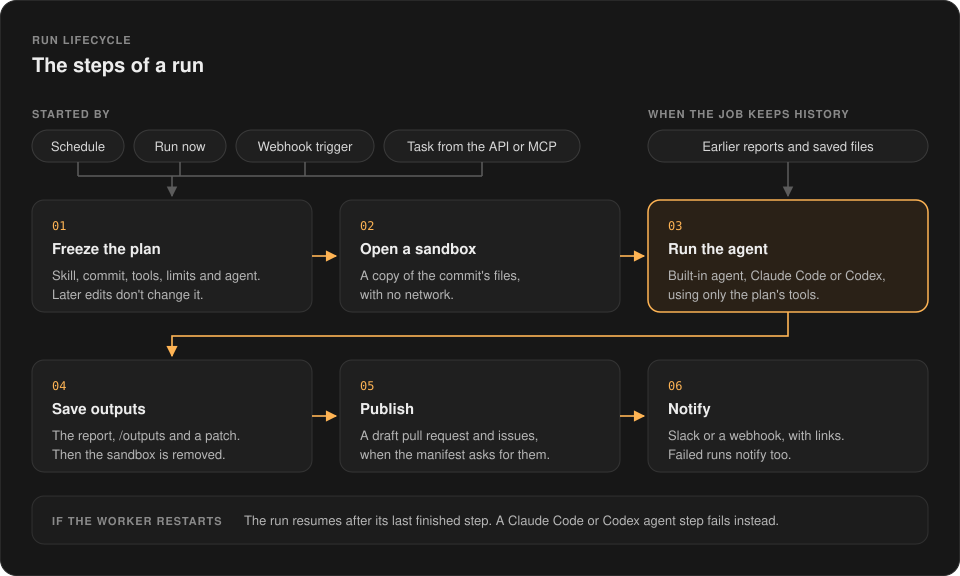
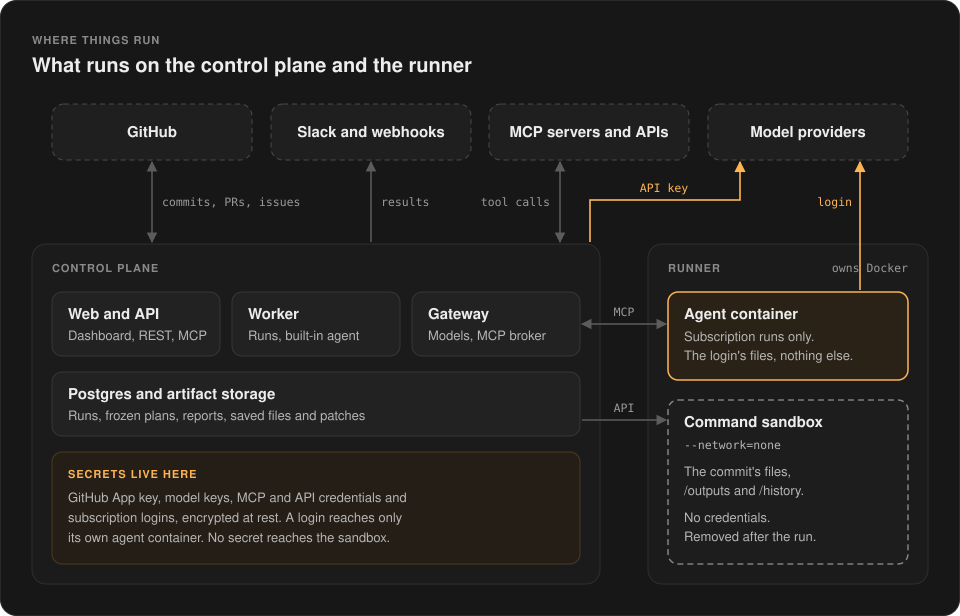
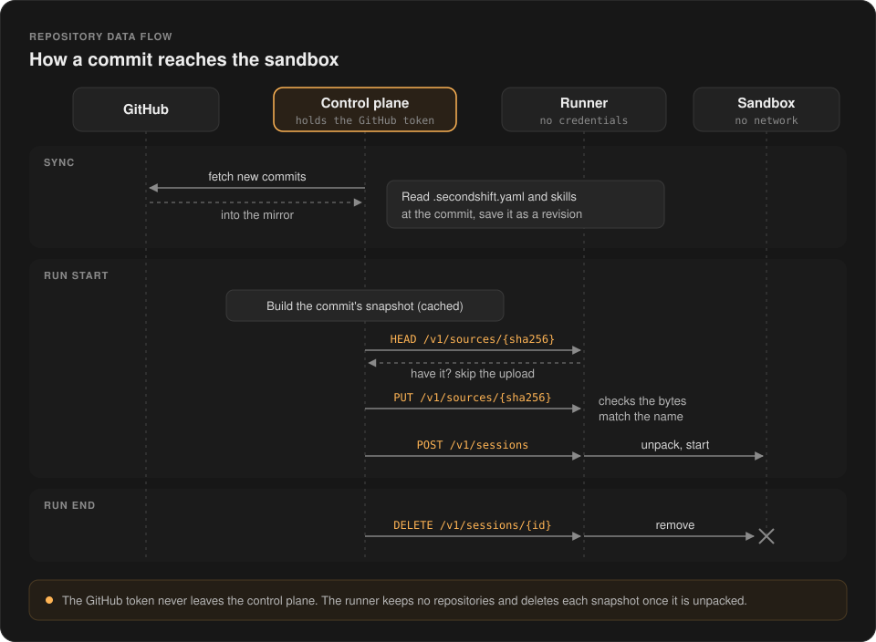

# Architecture

[README](../README.md) · [Security model](security-model.md) · [Self-hosting](self-hosting.md)

SecondShift runs your repository skills without handing them the keys:
* Credentials stay on the control plane. 
* Commands run in a sandbox with no network. 
* Every call to the outside world goes through a tool the workspace approved.

It has two parts. The **control plane** serves the dashboard and API, holds
every credential and runs each run's steps in a worker process. The **runner**
owns Docker and starts every container a run needs.

## How a run works

A run's plan is fixed when it starts, so manifest edits apply to the next run.
The agent works on a copy of the commit in a fresh sandbox. Before the sandbox
is removed, SecondShift saves the report, files in `/outputs` and a patch of
the changes. Pull requests, issues and notifications are built from these.

A job with [history](repository-configuration.md#run-history) also gives each
run the reports and saved files of earlier runs.

## Who decides what

| Concern | Example | Decided by |
| --- | --- | --- |
| Skill | `repository-health` | Repository author |
| Agent | Built-in agent, Claude Code or Codex | Workspace owner |
| Model | Claude, GPT or a local model | Workspace owner |
| Sandbox | Docker or `runsc` | Server operator |

A repository can ask for a skill and for capabilities. It can't pick the agent,
a credential, an image, a mount or the network. The workspace owner chooses one
model provider or subscription login on **Models**, and every job uses it. 

## Agent backends

Both kinds of agent get the same plan, tools, sandbox and limits. They differ in
how they pay for models and where their loop runs.

| | Built-in agent | Claude Code or Codex |
| --- | --- | --- |
| Pays with | A provider API key, per use | A person's subscription |
| Loop runs in | The worker, on the control plane | A container on the runner |
| Reaches models | Through the gateway | Directly, with the login |
| Reaches tools | Direct calls in the worker | The MCP broker on the gateway |
| Token usage | Metered by the gateway | Reported by the CLI |
| Out of budget | Writes a partial report | Stops without a report |
| After a crash | Resumes from the last model call | Stops. Start a new run. |

The built-in agent never sees a Docker socket or a provider key. Each model call
gets a short-lived gateway token that exists only inside that durable step.

Claude Code and Codex run in a container next to the sandbox. The container
holds only the login, with no Docker socket or host home directory. The
repository stays in the sandbox. The CLI reaches it the way the built-in agent
does, through tools that list, read and search files and run commands.

The CLI's own shell, file and web tools are switched off, so every action goes
through the MCP broker. The broker checks each call against the run, the login
and its owner.

These runs never restart on their own, because the agent may already have
changed things in other services.

[Agent subscriptions](agent-subscriptions.md) covers logins and setup.

### Sub-agents

A job can let its agent hand tasks to a set number of
[sub-agents](repository-configuration.md#sub-agents). Each one starts fresh,
uses the run's tools and budget, and can't start sub-agents of its own. The
agent waits for each report before it goes on. Codex runs without sub-agents.

## Where things run

- Only the runner can start containers. Each sandbox is fresh, capped on
  memory, CPU and processes, and has no network or credentials.
- For the built-in agent, the gateway picks the model, enforces the token
  budget and meters usage.
- The control plane runs only approved MCP tools and API operations, for
  either agent. These can change data in other services when the workspace
  owner allows it. The built-in GitHub and Sentry tools only read.
- Large outputs go to private artifact storage.

## Repository data flow

The runner never talks to GitHub, and the GitHub token never leaves the control
plane. A run gets a snapshot: the files of one commit, built from Git objects,
with no history. The repository's `.gitattributes` can't hide or change
anything in it.

The runner keeps no repositories. It deletes a snapshot once a session unpacks
it, or after an hour if no session does. The control plane's mirror and snapshots are caches, so losing them costs
only a fetch. The exception is a commit that a force push removed from GitHub.
Once the cache loses it, it can't be run again.

Local repositories skip the mirror. Their snapshots come straight from the
folder on disk.

## The security boundary

A run gets a tool only if the repository asks for it, a workspace connection
provides it and the owner grants it. If required access is missing, the run is
refused before it starts.

Repository content and model output are untrusted. Commands stay in the
sandbox. Calls to other services go through the control plane, which checks
each one against the frozen plan.

Each credential is decrypted only where it's used. The gateway decrypts model
keys, and the control plane decrypts MCP and API credentials for each call. A
subscription login goes to the runner sealed with the runner's key, and only
its own agent container gets it. None ever appears in repository
configuration, workflow arguments, plans or sandboxes. The sandbox and these
checks are the boundary. Shell allowlists are not.

The [security model](security-model.md) covers where each secret lives and the
risks that remain.
