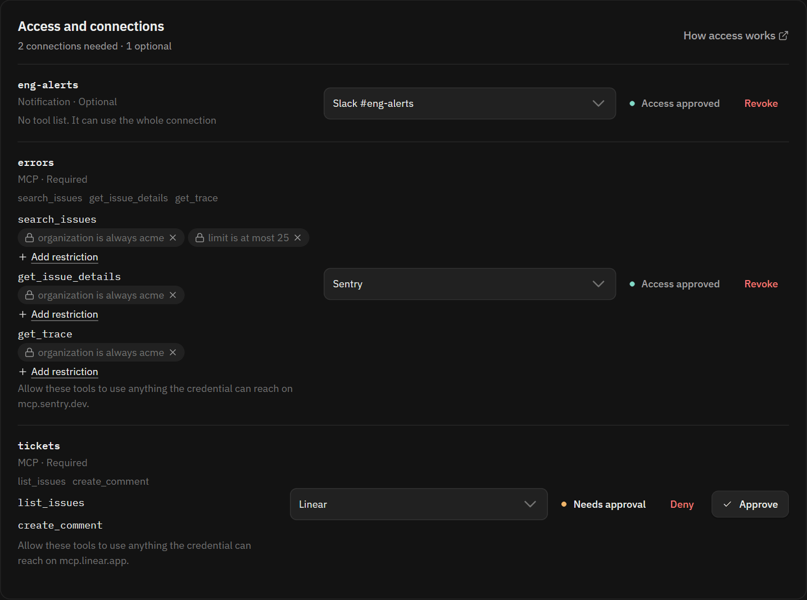
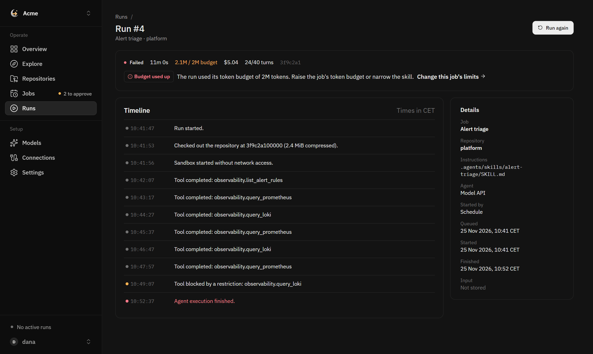

# Evaluating SecondShift

[README](../README.md) · [Alternatives](comparisons.md) · [Security model](security-model.md) · [Control](control.md)

Before adopting an agent platform, most teams want to know four things: how
hard it is to move away, what data leaves their network, what an agent can
touch, and what it can spend. This page answers each and links to the details.

## No lock-in

SecondShift runs on your own server and needs no hosted service of ours.

- **License.** Apache 2.0. The server, dashboard, runner and agent image are
  all in [the repository](https://github.com/piotrekno1/second-shift).
- **Jobs live in your repositories.** A job is an entry in
  `.secondshift.yaml` and a `SKILL.md` of plain Markdown instructions. Both
  stay in Git if you stop using SecondShift, and any other agent can read them.
- **Any model.** Use an Anthropic, OpenAI or OpenRouter key, any
  [OpenAI-compatible endpoint](models.md) including a local one, or a team
  member's [Claude Code or Codex subscription](agent-subscriptions.md).
  Switching providers doesn't touch the jobs.
- **Standard integrations.** Services connect over MCP or an OpenAPI 3 HTTP
  API, so there are no SecondShift plugins to write.
  [Connections](connections.md) has examples for Linear, Grafana and others.
- **Your database.** Runs, reports and settings live in your own PostgreSQL.
  Output files go to your disk or S3-compatible storage. Read runs and reports
  through the [MCP endpoint and API tokens](mcp.md).

## Private by default

SecondShift has no telemetry, so there is nothing to opt out of. The server
only calls what you set up: your model provider, GitHub, the services you
connect and the places you deliver reports to.

- Claude Code and Codex can reach only their provider's API and sign-in
  hosts. Claude Code also runs with its telemetry, error reports and update
  checks turned off.
- The dashboard loads its fonts from Google Fonts, so each viewer's browser
  contacts Google. The server itself makes no such call.
- Prompts and tool results go to the model provider you chose, under that
  provider's terms. To keep them on your network, use a
  [local model](models.md#keep-data-local).

## Agents stay contained

A run reaches three things: a sandbox, the model, and a broker for approved
tools. The [security model](security-model.md) covers each one.

- **Commands run in a sandbox without network access.** Each run gets a fresh
  container with no network, no credentials, a read-only root filesystem and
  capped memory, CPU and processes. Production requires gVisor and refuses
  to start without it.
- **The agent never holds your credentials.** Service tokens stay in the
  control plane. The agent asks a broker to call a tool, and the broker checks
  every call against the run's frozen plan.
- **Owners decide access.** A repository can ask for tools. Only a workspace
  owner chooses which tools a connection allows, approves a job's request, and
  can fix or limit the arguments a job may send. Owners can also let merging
  a change approve requests for allowed tools.
- **Changes go through review.** Code changes arrive as draft pull requests,
  pushed after the run by the control plane, not the agent. By default, CI
  doesn't run on them until a person has reviewed the patch.
- **Every call is on the record.** Each run's timeline lists the tools it
  called and any call a restriction blocked.

The security model also lists the [remaining risks](security-model.md#remaining-risks).
The main one: an agent can misuse any tool an owner approved, within the
restrictions set on it. Approve read-only tools where you can.

## Spend is capped per run

Each run has a limit on model calls, tool calls, tokens and time. Owners set
defaults for the workspace and override them per job. The server operator sets
the maximum for each. A run that uses its budget stops and keeps the work it
has done so far.

Webhook triggers have a cap on runs per hour, and subscription logins a cap on
runs per day. The worker runs two runs at once by default.

The Overview shows the last seven days of model spend, per job, against the
week before. There is no workspace-wide budget per day or month, so also set a
spending limit with your model provider. [Spend](spend.md) covers every
setting.

## Who does what

The server operator deploys SecondShift and sets the sandbox and the limit
maximums. A workspace owner connects services, approves access and sets
limits. Admins run and schedule approved jobs. Members can only look.
Repository contributors propose jobs and the access they need in a pull
request. See [roles](access.md#roles).

## Try it

1. [Run it locally](../README.md#quick-start) with `secondshift up`. It needs
   Docker and a model API key or subscription.
2. Try a skill from [Explore](explore.md) on one of your repositories.
3. Read its run timeline and usage, then follow
   [Before you schedule a job](control.md#before-you-schedule-a-job).
4. [Deploy for your team](production-deployment.md) when you are ready.
