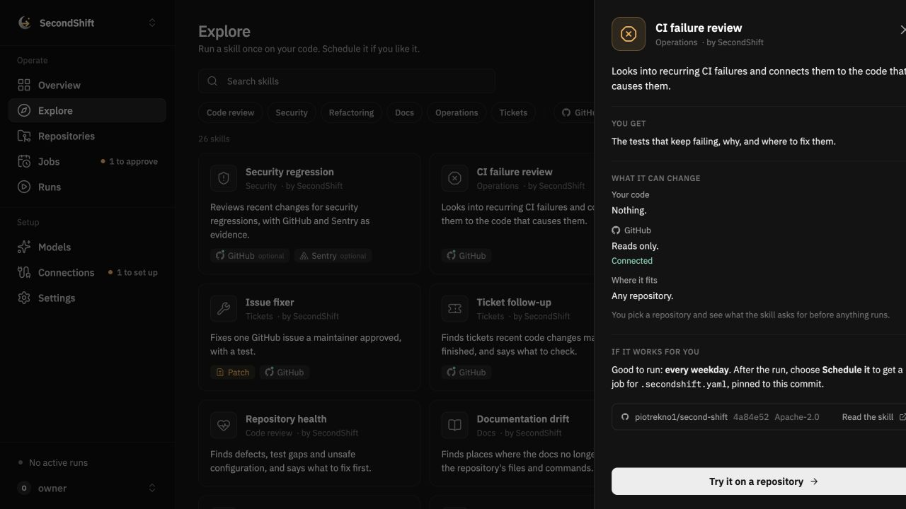
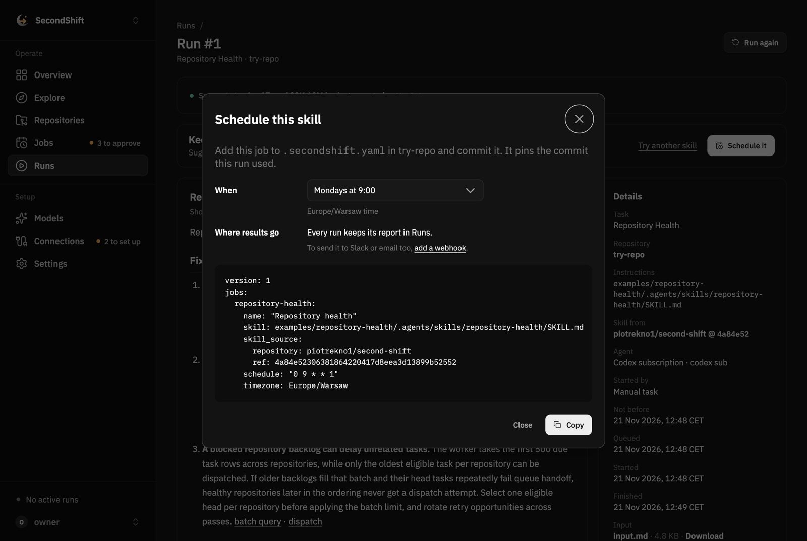

# Explore skills

Explore is the list of skills in the dashboard. Run one once on your own
code, and if you like the result, schedule it as a job. It has the examples
from the [skill catalog](../examples/README.md) and skills other people
published on GitHub, each pinned to a commit.

<video src="https://github.com/user-attachments/assets/2e48124d-489f-449b-be66-25107697e9b0" poster="/media/ci-fixer-walkthrough.jpg" controls playsinline preload="metadata" width="100%"></video>

[Watch the 48-second walkthrough](https://github.com/user-attachments/assets/2e48124d-489f-449b-be66-25107697e9b0). A CI check fails on two pull
requests. The CI failure fixer from Explore traces both failures to one bug,
opens a draft fix, and a second draft schedules it.

## Find a skill

Open **Explore** in the sidebar. Each card says what the skill does and who
publishes it. Some skills come from SecondShift, others from their authors on
GitHub.

Filter by what the skill is for, such as **Code review** or **Operations**,
or by a product it works with, such as **Sentry** or **Django**. Choose a
filter again to turn it off. SecondShift's own skills come first, and among
them the ones that use a service you already connected.

A card also shows what the skill can change:

- **Patch** means it gives you a patch for your code. No chip means it leaves
  your code alone.
- A service name means the skill uses that service. **optional** means it
  works without it, with less to go on. **writes** means it can change
  things there, through tools an owner approves.

Select a card to read more:

- what the skill gives you
- a shortened excerpt from a run the SecondShift team did, when there is one
- what it can change in your code and in each service, and which services
  are connected
- how often it is worth running
- the repository, the pinned commit and the license, with a link to read the
  skill itself

The address of an open skill can be shared. It opens Explore on that skill.

## Try it

1. Select **Try it on a repository**. If the skill needs a service that isn't
   connected yet, the button asks you to connect it first, for example
   **Connect Sentry to try it**. That opens the form for the service, with
   **Back to skill** to return.
2. Choose one of your repositories. To add one, select **Add repository**.
   You come back to the skill when you're done.
3. SecondShift checks the skill and shows what it asks for. Nothing runs
   yet.
4. Select **Queue task**.

Trying a skill needs no `.secondshift.yaml`. The skill is mounted read-only
and runs on your repository like any
[one-off task](tasks.md#try-a-skill-from-github).

## Keep it running

When a run you started from Explore succeeds, the run page asks whether to
keep the skill running. Select **Schedule it**.

The dialog starts from what the skill suggests:

- **When**: every weekday, every day, Mondays, the 1st of each month, or
  only when someone runs it. Each starts at 9:00 in your browser's timezone.
- **Where results go**: the notification connections to send the report to.
  For skills that open issues or give a patch, you can also choose to
  propose GitHub issues or open a draft pull request.

The job below updates as you choose. It pins the commit the run used.

On a GitHub repository where an owner allows pull requests, select **Open
pull request**. SecondShift adds the job to `.secondshift.yaml` on the
default branch and opens a draft pull request with that one change. The rest
of the file stays as it was. The job starts once you merge it and the
repository syncs. If the file already has a job with that name, change the
name and try again.

Anywhere else, select **Copy**, add the job to `.secondshift.yaml` in that
repository and commit it.

The job doesn't list the tools the skill needs. If it uses a service, add
the tools under `requires`, and an owner approves them. See
[skills from another repository](repository-configuration.md#skills-from-another-repository).

## Skills that aren't listed

Select **Try from a link** and paste a GitHub link to a `SKILL.md`. It runs
once, like a listed skill, but nobody here has tested it. Read what it asks
for before you queue it.

## Where the list comes from

The list ships with SecondShift. A new release can add skills or move their
pins. SecondShift doesn't fetch the list from anywhere, so Explore works on
installs without internet access, although trying a skill still reads it
from GitHub.

Every skill is pinned to a commit. A change the author makes later reaches
Explore only when a release moves the pin.

## Suggest a skill

To suggest a skill, open a pull request that adds it to
[the catalog file](../dashboard/src/catalog/skills.json), pinned to a commit.
Run `npm run check:catalog` in `dashboard` to check the pin and the license.
The pull request runs the same check. If you'd rather not edit the file, open
an issue with a link to the skill's `SKILL.md`. Either way, try it on your own
code first with **Try from a link**. See [contributing](../CONTRIBUTING.md)
for the rest.

A skill gets listed when:

- It runs unattended. It doesn't stop to ask questions.
- It does the work, such as a report, a patch or tickets, rather than only
  giving guidance.
- It lives in a public GitHub repository under MIT, Apache-2.0, BSD, ISC or
  CC-BY-4.0. Some repositories license their skills apart from their code.
  Then the skill's own license counts.
- It names the services it needs and what it changes in each.
- A maintainer ran it on a real repository and the result was worth reading.
  The skill's panel shows an excerpt from that run's report.
