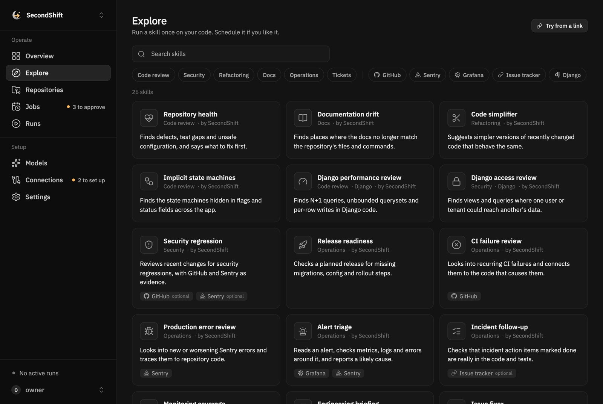

# Explore skills

Explore is a list of skills you can run once on your own code. If you like
the result, you schedule it as a job.

## Find a skill

Open **Explore** in the sidebar. Each card says what the skill does and who
publishes it. Some skills come from SecondShift, others from their authors on
GitHub.

Filter by what the skill is for, such as **Code review** or **Operations**,
or by a product it works with, such as **Sentry** or **Django**. Choose a
filter again to turn it off. SecondShift's own skills come first, and among
them the ones that use a service you already connected.

A card also shows what the skill can change:

- **Patch** means it gives you a patch for your code. No chip means it leaves
  your code alone.
- A service name means the skill uses that service. **optional** means it
  works without it, with less to go on. **writes** means it can change
  things there, through tools an owner approves.

Select a card to read more:

- what the skill gives you
- a shortened excerpt from a run the SecondShift team did, when there is one
- what it can change in your code and in each service, and which services
  are connected
- how often it is worth running
- the repository, the pinned commit and the license, with a link to read the
  skill itself

The address of an open skill can be shared. It opens Explore on that skill.

## Try it

1. Select **Try it on a repository**. If the skill needs a service that isn't
   connected yet, the button asks you to connect it first, for example
   **Connect Sentry to try it**. That opens the form for the service, with
   **Back to skill** to return.
2. Choose one of your repositories. To add one, select **Add repository**.
   You come back to the skill when you're done.
3. Select **Check skill**. SecondShift shows what the skill asks for. Nothing
   runs yet.
4. Select **Queue task**.

Trying a skill needs no `.secondshift.yaml`. The skill is mounted read-only
and runs on your repository like any
[one-off task](tasks.md#try-a-skill-from-github).

## Keep it running

When a run you started from Explore succeeds, the run page asks whether to
keep the skill running. Select **Schedule it**.

The dialog starts from what the skill suggests:

- **When**: every weekday, every day, Mondays, the 1st of each month, or
  only when someone runs it. Each starts at 9:00 in your browser's timezone.
- **Where results go**: the notification connections to send the report to.
  For skills that open issues or give a patch, you can also choose to
  propose GitHub issues or open a draft pull request.

The job below updates as you choose. Copy it into `.secondshift.yaml` in
that repository and commit it. It pins the commit the run used.

The job doesn't list the tools the skill needs. If it uses a service, add
the tools under `requires`, and an owner approves them. See
[skills from another repository](repository-configuration.md#skills-from-another-repository).

## Skills that aren't listed

Select **Try from a link** and paste a GitHub link to a `SKILL.md`. It runs
once, like a listed skill, but nobody here has tested it. Read what it asks
for before you queue it.

## Where the list comes from

The list ships with SecondShift. A new release can add skills or move their
pins. SecondShift doesn't fetch the list from anywhere, so Explore works on
installs without internet access, although trying a skill still reads it
from GitHub.

Every skill is pinned to a commit. A change the author makes later reaches
Explore only when a release moves the pin.

## Getting a skill listed

You can't submit skills yet. This is the bar we use for our own list:

- It runs unattended. It doesn't stop to ask questions.
- It does the work, such as a report, a patch or tickets, rather than only
  giving guidance.
- It lives in a public GitHub repository and has a license.
- It names the services it needs and what it changes in each.
- The SecondShift team ran it on a real repository, and the result was worth
  reading.

Until submissions open, anyone can run a skill with **Try from a link**.
