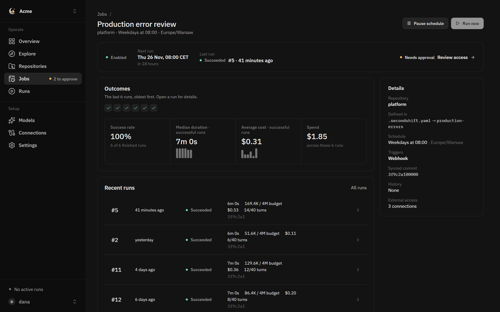

# Repository jobs

[README](../README.md) · [Repository configuration](repository-configuration.md) · [Connections](connections.md)

A repository job is a skill and an entry in `.secondshift.yaml`. It runs on a
schedule, from a webhook, or when you choose **Run now**. A job can investigate
code, write a briefing, or change data in a connected service through tools an
owner approved.



For a one-time request without repository configuration, use
[one-off tasks](tasks.md). You can write instructions directly, queue work for
later, and review its report in Runs.

## Your first job

Create `.agents/skills/repository-review/SKILL.md`:

```markdown
# Repository review

Read the README and inspect the source for correctness problems and outdated
documentation. Run the documented tests if their dependencies are available.
Do not install packages, use the network, or modify files.

Report confirmed findings with file paths, line numbers, user impact, and a
suggested fix. List the checks you ran and anything you could not verify.
```

Add `.secondshift.yaml`:

```yaml
version: 1

jobs:
  repository-review:
    name: Weekly repository review
    skill: .agents/skills/repository-review/SKILL.md
    schedule: "0 9 * * 1"
    timezone: Europe/Warsaw
```

Commit both files, add the repository in SecondShift, and connect a
[model](models.md). Open the discovered job and choose **Run now** to try it.

**Begin with a manual run, check its results and tool activity, then enable a
schedule if useful.** Verify that the job can reach its intended data and
complete the intended work before it runs unattended. For a review, check the
findings and coverage. For an action task, verify the resulting service state.
Then [set its limits](control.md#before-you-schedule-a-job) and enable the
job to run on its schedule.

The sandbox has no network access or provider credentials. Reading files and
running standard-library tests work without installing packages. A job that
needs other tools can name an
[environment](repository-configuration.md#environments) the server defines, or
install its dependencies with
[setup commands](repository-configuration.md#setup-commands) if the server
allows them.

## Start from an example

The [skill catalog](../examples/README.md) has ready-made skills. Each example
lists the data it needs and suggests a schedule. The
[documentation drift example](../examples/docs-drift/README.md) needs only a
model.

Copy the skill directory from `examples/<name>/.agents/skills` into your own
`.agents/skills`. Copy the directory itself, not the root discovery symlink.
Then add a job to `.secondshift.yaml`.

To try a skill before copying it, open it in [Explore](explore.md) or run it
once as a [one-off task](tasks.md#try-a-skill-from-github).

## Use connected services

A job asks for a service by a binding name, such as `sentry`, and lists the
exact tools it needs under `requires.mcps` or `requires.apis`. A workspace
owner connects the service under that name and chooses which tools jobs may
use. A skill file does not grant access by itself. See
[Connections](connections.md) for what you can connect, and
[Services](services.md) for approvals. Calls
run outside the sandbox.

A production error review can use the built-in Sentry connection:

```yaml
version: 1
jobs:
  production-error-review:
    name: Production error review
    skill: .agents/skills/production-error-review/SKILL.md
    schedule: "0 8 * * *"
    timezone: UTC
    requires:
      mcps:
        - binding: sentry
          tools:
            - search_issues
            - search_errors
            - search_traces
            - get_sentry_resource
```

Create the Sentry connection with binding `sentry` and choose the organization
or project to review. Confirm that the requested tools are available on that
connection, sync the committed configuration, and approve the job's request if
the connection requires it. Use **Run now** to verify the report before
enabling the daily schedule.

CI, monitoring and incident tools depend on the service you connect. Select
operations that expose the history and records each example describes. Use the
tool names SecondShift shows rather than guessing them. The built-in GitHub
connection reads pull requests, commits, and GitHub Actions runs and job logs.
The [CI failures example](../examples/ci-failure-review/README.md) uses it.

To send the report somewhere, add a webhook connection and approve each job's
notification access. See
[deliver reports to a webhook](repository-configuration.md#deliver-reports-to-a-webhook).

## Tasks that change service data

Custom MCP and HTTP API connections can expose write operations. The workspace
owner must allow the operation on the connection and approve the job's request.
The built-in GitHub and Sentry connections expose read tools only. Use a custom
connection with the required operations for actions such as Jira transitions.

The [ticket reconciliation skill](../examples/ticket-reconciliation/README.md)
implements this workflow for an approved tracker, such as Jira:

1. Find candidate issues in the approved project.
2. Check linked implementation, validation, and deployment evidence against
   the team's definition of fixed. A merged PR alone may not meet that definition.
3. Transition only issues that meet those criteria and verify the resulting state.
4. Summarize changed issues, skipped issues, and failures with evidence links.

Select the service's actual read and transition operations, then declare their
exact names in the job's `requires` section. Keep the project, credentials, and
endpoint configuration in the workspace connection. The provider-neutral sample
requires the tracker's actual operation names before it can run. For teams that
want a person to decide, the [ticket follow-up brief](../examples/ticket-follow-up/README.md)
returns candidates without changing tickets and can be delivered to Slack.

Write the skill's completion criteria and stopping conditions explicitly.
Check current state before acting, skip already-completed transitions, and
avoid duplicate comments on reruns. If a write times out, check its outcome
before retrying. Start with a read-only preview of proposed changes when useful,
then test the approved action workflow manually before enabling its schedule.
Access approval permits the tool calls. It does not guarantee that the model
will apply your business rules correctly. See the
[security model](security-model.md#remaining-risks).

## Execution environment

The sandbox contains the repository at the run's commit, without network access.
Git history and project dependencies may be absent. Historical comparisons need
available Git data or approved tools. Each skill reports unavailable evidence
instead of treating it as proof that nothing is wrong.

## Run the same skill locally

A skill is plain instructions, so a coding agent can run it on your machine
too. Name the skill and its scope explicitly, for example:

```text
Use $release-readiness-review to review the planned release described in our
committed release notes. Report missing rollout steps and unavailable evidence.
```

Local agent use follows that agent's permissions. SecondShift's sandbox and
broker controls apply only when the skill runs as a SecondShift job.
