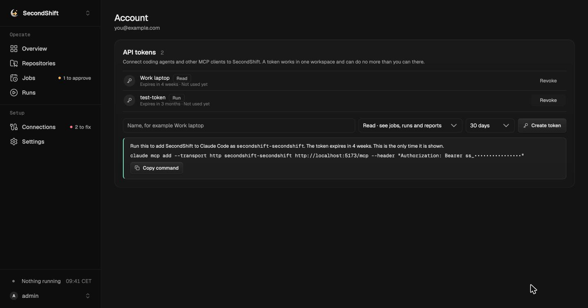

# MCP server

[README](../README.md) · [Security model](security-model.md) · [Repository configuration](repository-configuration.md)

SecondShift serves an MCP server at `/mcp` for coding agents and other
integrations. An agent can read jobs, runs and reports, start approved jobs,
and check a `.secondshift.yaml` before it is committed. An agent can never
grant access. Approvals, connections and secrets stay in the dashboard.



## Connect a client

1. Open the account menu and choose **API tokens**.
2. Name the token. Pick the workspace it works in, its access and when it
   expires.
3. Choose **Create token** and copy the setup command. The token is shown
   once.

Claude Code:

```bash
claude mcp add --transport http secondshift-acme https://secondshift.example.com/mcp \
  --header "Authorization: Bearer ss_..."
```

The server name ends with the workspace's slug. Someone in several
workspaces adds one server per workspace, and the names do not clash.

Other clients use the same URL and header. The server speaks Streamable HTTP.
A client that reads a JSON config takes the same values:

```json
{
  "mcpServers": {
    "secondshift-acme": {
      "type": "http",
      "url": "https://secondshift.example.com/mcp",
      "headers": { "Authorization": "Bearer ss_..." }
    }
  }
}
```

In local mode the server is at `http://127.0.0.1:8000/mcp` while
`secondshift up` runs. Create the token from the account page there too. There
is no stdio transport. Every client uses a token, so the same access rules and
expiry apply everywhere.

## API tokens

A token belongs to one person and works in one workspace. People manage
their own tokens from their account page, across every workspace they belong
to. A token has one of two kinds of access.

| Access | Allows | Creator needs at least |
| --- | --- | --- |
| `read` | Every read and manifest tool | Member |
| `run` | Everything in `read`, plus starting runs and syncing repositories | Admin |

A `run` token can start runs. Runs spend model budget. A run may change data
in connected services through tools an owner approved for its job. The form
says so when `run` is picked. It offers `run` only for workspaces where the
person is an admin or owner. With one workspace, the form has no workspace
picker.

A token covers one workspace so that content from one workspace cannot steer
an agent into another. A prompt injection in one workspace's report cannot
reach a second workspace's reports or jobs. A leaked token exposes one
workspace.

Rules:

- Access is the token's kind limited by the creator's current role. It is
  checked on every request. A demoted creator's `run` token can only read. A
  creator who leaves the workspace loses every token for it.
- Owner actions are never available to a token. These include grants,
  approvals, connections, secrets, model providers, limits and members.
- Only a hash of the token is stored. Tokens start with `ss_` so secret
  scanners can find leaked ones.
- Every token expires. The creator picks 7, 30 or 90 days. The default is 30.
  The server's `SECONDSHIFT_API_TOKEN_MAX_DAYS` (90 by default) caps the
  choice and is always offered. No token lasts forever.
- Lowering the maximum affects only new tokens. Existing tokens keep their
  expiry.
- A person can revoke their own tokens. An owner limits other people's
  tokens through membership. Removing someone stops their tokens at once.
  Demoting them to member makes their `run` tokens read only.
- The token list shows each token's name, access, expiry and last use. It
  shows the workspace when the person belongs to several.

## Tools

All tools act on the token's workspace. IDs are the same as in the dashboard.
An ID from another workspace is reported as not found.

### Jobs and runs

| Tool | Access | Arguments | Returns |
| --- | --- | --- | --- |
| `list_jobs` | `read` | `repository_id?`, `enabled?` | Each job's ID, key, name, repository, schedule, whether it is enabled, and whether it is ready to run. A job that is not ready lists what blocks it. |
| `get_job` | `read` | `job_id` | The job's details, limits and recent runs, and whether it is ready to run. |
| `list_runs` | `read` | `job_id?`, `repository_id?`, `status?`, `period?`, `page?`, `page_size?` | A page of runs, newest first, with status, times and token usage. Page size is at most 50. |
| `get_run` | `read` | `run_id` | Status, events, model usage and the start of the output. |
| `get_run_report` | `read` | `run_id` | The run's Markdown report. A report over 200 KB is cut and marked as cut. |
| `run_job` | `run` | `job_id` | The new run's ID and status. Poll `get_run` to follow it. |
| `sync_repository` | `run` | `repository_id` | The synced commit, whether the manifest is valid, and the repository's jobs. |

`run_job` follows the same rules as **Run now** in the dashboard. It fails
with a plain message when the repository is disabled, no default model is
connected, or a required capability is not approved.

`run_job` also refuses while the job already has a queued or running run. It
returns that run's ID instead, so the agent can follow it with `get_run`. An
agent stuck in a loop cannot queue runs faster than they finish. **Run now**
follows the same rule.

### Writing manifests

| Tool | Access | Arguments | Returns |
| --- | --- | --- | --- |
| `list_bindings` | `read` | none | Each binding in the workspace with its kind, whether it is connected, and the tools a job may request. Each tool has a name, description, input schema and a flag for tools that may change data. Built-in GitHub and Sentry tools are listed even when they are not connected. |
| `check_manifest` | `read` | `yaml`, `repository_id?` | Whether the manifest is valid, with the same error a sync shows. For a valid manifest, each job's bindings with their status in this workspace: `ready`, `missing`, `needs_approval` or `unavailable`. |
| `list_capability_needs` | `read` | none | What every job in the workspace has requested and what is still missing. |

`list_bindings` shows only tools an owner allowed on the connection. It
reports how many other tools exist without naming them. A job that requests a
tool the owner has not allowed cannot run, so listing it would only create
approval requests.

`check_manifest` does not read the repository. It checks that skill paths
are well formed but cannot check that the files exist. A sync reads them from
the committed revision. Pass `repository_id` to count approvals that the
repository's synced jobs already have.

## Rate limit

Each person can make `SECONDSHIFT_MCP_RATE_LIMIT` requests to `/mcp` per
minute (300 by default). All of their tokens share the limit, so a new token
does not reset it. The dashboard is not limited by it. A request over the
limit fails with "Too many requests." and a `Retry-After` header with the
seconds to wait.

Runs are already bounded by their own limits, the worker queue and the
workspace token budget. The rate limit only stops runaway clients.

## What is not exposed

| Left out | Why |
| --- | --- |
| Grants and approvals | An agent driven by repository content must not approve its own access. |
| Enabling a job's schedule | Letting a job run unattended is a human decision. |
| Connections, secrets and model providers | Owner only. Credentials never leave the server. |
| Endpoints, server URLs, auth types and OAuth details | A manifest may not contain them. An agent that never sees them cannot copy them into one. |
| Limits, members and invites | Owner or admin settings with no use in an agent loop. |
| Local repository paths | They describe the host's file system. |

## Untrusted content

Reports, run events and tool descriptions are untrusted. Reports are model
output built from repository content. Tool names, descriptions and schemas
of custom MCP servers and HTTP APIs come from third parties. Any of them can
contain instructions aimed at the agent that reads them.

Results that carry this content include a note saying so. Tool descriptions
are cut at 500 characters. A client should treat a report as data to act on,
not as instructions.

## Audit

Each tool call is recorded with the tool name, the token, its creator and
whether it succeeded. Arguments and results are not recorded. Requests
refused by the rate limit are not recorded. Records are deleted after
`SECONDSHIFT_RUN_RETENTION_DAYS`, like run history.
