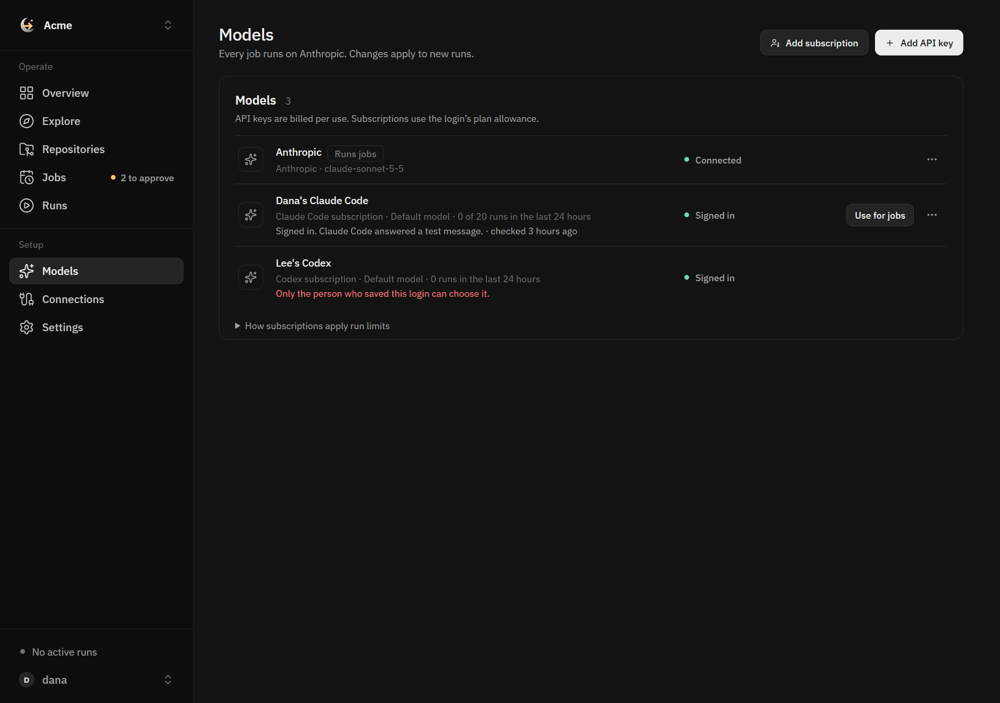

# Models

[README](../README.md) · [Agent subscriptions](agent-subscriptions.md) · [Control](control.md)

Every job in a workspace runs on one model connection, chosen by a workspace
owner on **Models**. It can be an API key, billed per use, or a person's Claude
Code or Codex subscription, which uses that plan's allowance. Switching it
changes the next run of every job. A repository cannot choose the model or the
provider.

## API keys

Choose **Add API key**. Anthropic, OpenAI and OpenRouter need only the key. For
other providers with an OpenAI-compatible chat completions API, choose
**OpenAI-compatible** and enter the base URL and key.

| Provider | Connection | Base URL |
| --- | --- | --- |
| Anthropic | Anthropic | Preset |
| OpenAI | OpenAI | Preset |
| OpenRouter | OpenRouter | Preset |
| Fireworks AI | OpenAI-compatible | `https://api.fireworks.ai/inference/v1` |
| Together AI | OpenAI-compatible | `https://api.together.xyz/v1` |
| Baseten | OpenAI-compatible | `https://inference.baseten.co/v1` |
| [CoreWeave Serverless Inference](https://wandb.ai/site/inference/) | OpenAI-compatible | `https://api.inference.wandb.ai/v1` |
| [Nebius Token Factory](https://dev.nebius.com/token-factory) | OpenAI-compatible | `https://api.tokenfactory.nebius.com/v1` |

Runs call tools, so choose a model that supports tool calling. The endpoint
must also return token usage in streaming responses, which per-run token
budgets need.

Amazon SageMaker endpoints use AWS request signing, not an API key. Put an
OpenAI-compatible proxy such as LiteLLM in front of them.

The key is encrypted in the database. Only the model gateway decrypts it, for
each model call. The agent, the sandbox and the model never see it. See
[where secrets live](security-model.md#where-secrets-live).

### Default and allowed models

Each key has a **Default model**, which runs use, and an optional list of
**Allowed models**. When the list is set, the gateway refuses a call to any
other model. Leave it empty to allow any model the provider offers.

### Cost

Runs on an API key show their cost on the job page and in **Runs**, next to
their tokens, and the Overview totals the week by job. Each run stops at its
[token budget](spend.md#run-limits).
SecondShift has no monthly budget, so set a spending limit with the provider
too.

## Subscriptions

Choose **Add subscription** to run jobs through Claude Code or Codex, signed in
with a person's own plan. A subscription needs the agent image on the runner.
Each login can cap how many runs use it a day. See
[Agent subscriptions](agent-subscriptions.md) for setup, plan terms and how
these runs are isolated.

## Keep data local

The model provider receives what a run sends it, including repository content
the agent reads. Running SecondShift on your own server does not change that.
Where content must stay with you, connect an OpenAI-compatible model you host
yourself, such as one served by vLLM or Ollama. A server calls only public
HTTPS addresses, so give the model one on infrastructure you control.
`secondshift up` on one machine also accepts a local address, such as
`http://localhost:11434/v1`.
