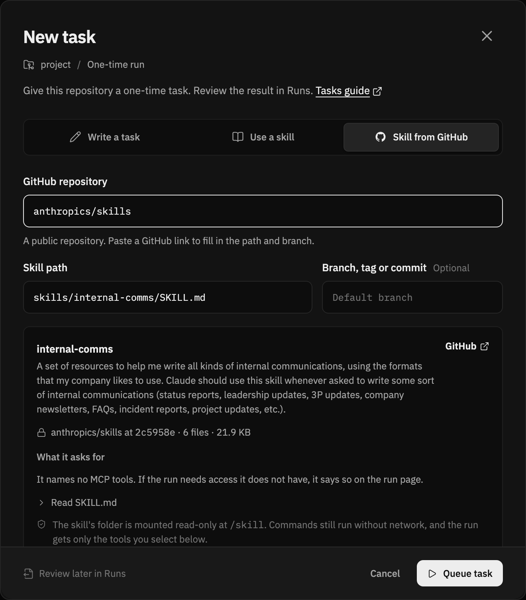
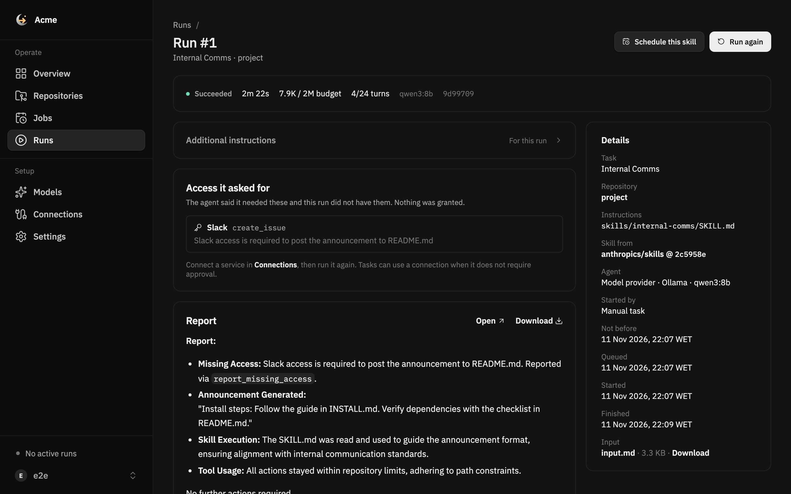

# SecondShift 0.1.0b11

This beta runs skills from other public GitHub repositories. You can try one
as a task, run a task again from its run page, and schedule a skill without
copying it into your repository. Runs can also say what access they were
missing. The dashboard has a calmer design and one page for adding
repositories.

## Skills from other repositories

- New task has a **Skill from GitHub** tab. Paste a link to a `SKILL.md` in
  a public repository and press Check skill. SecondShift pins it to a commit
  and shows its description, size, text and the MCP tools it names, with
  whether this workspace has them. Nothing runs until you queue the task.
- A job can use a skill from another repository with `skill_source` in
  `.secondshift.yaml`. Name the repository and a branch, tag or commit. See
  [skills from another repository](../repository-configuration.md#skills-from-another-repository).
- The skill's folder is mounted read-only at `/skill`. It is fetched without
  credentials, pinned to a commit and checked by hash in the runner. Links in
  the skill's folder are refused. Commands still run without network, and the
  run still gets only the tools its plan allows.
- Coding agents can run these skills through the MCP `submit_task` tool.
- Operators can turn this off with `SECONDSHIFT_EXTERNAL_SKILLS_ENABLED=false`
  in web and worker.

## Run again and missing access

- A task's run page has **Run again**. It queues the same task with the same
  instructions, skill and tools. A branch, or a ref that no longer exists,
  resolves to its newest commit.
- **Schedule this skill** shows the `.secondshift.yaml` lines that turn a
  task's skill into a scheduled job.
- An agent can report access it needed and did not have. The run page lists
  it under "Access it asked for", and links to Connections. Nothing is
  granted by reporting it.

## Dashboard

- A calmer design with IBM Plex, quieter surfaces and the same row style in
  every list. A click on a row opens it, and buttons in the row do their own
  action.
- **Add repository** opens one page for GitHub and local folders. When GitHub
  refuses to list repositories, it says why and offers to reconnect.
- Jobs group under their repository, with Failing, Scheduled, Webhook, Manual
  and Removed filters. Schedules read like "Every 6 hours".
- The job page has the access review, so a reviewer approves it there. Run
  is disabled when an approved connection has expired or was disconnected.
- The Connections page splits GitHub into repository access and job tools.
- The Overview runs chart counts this week, with last week as gray totals.

## Fixes

- A job run's tool calls and notifications now check its connection the way
  ad hoc runs do. The connection must still be connected, and match the
  capability the run was planned with. Before, an expired connection or one
  whose binding changed after planning was still used.
- An API key or token past its expiry no longer approves a capability
  automatically or passes a run's access check. Before, only the dashboard
  and planning treated it as expired.
- An MCP sign-in now checks the person's role again when it finishes. Before,
  a person demoted during the sign-in could still add the connection.
- Errors from a local repository no longer include Git's own output, which
  could name folders on the server.
- A subscription agent that times out or runs out of budget now records the
  same failure as the built-in agent. Before, it showed as a general failure.
- `secondshift up` can start again right after it stops. Before, it could
  report the port as in use for about a minute.
- `secondshift up` now passes `SECONDSHIFT_AGENT_RESOLV_CONF` to the runner.
  Before, the local runner ignored it.
- A job removed from `.secondshift.yaml` no longer counts as ready to enable
  on its repository page. Before, "Enable jobs" tried to switch it on and
  failed.
- Overview's "Needs approval" list now shows the same jobs as the Jobs page
  filter and the sidebar count. Before, it also listed jobs whose access was
  denied.

## Upgrade from beta 10

Keep your data, private environment files and encryption keys. Install the new
wheel or pin `ghcr.io/piotrekno1/second-shift:0.1.0b11`, then follow the normal
[upgrade procedure](../production-deployment.md#update-and-back-up). Wait for
container publishing to finish before pulling the image. Beta releases do not
advance the stable `latest` tag.

- Let queued and running runs finish before upgrading. This release drops the
  code that let runs started by an older version finish after the upgrade.
- Upgrade the runner together with web, worker and gateway. The runner checks
  the new skill hash, so an old runner and a new control plane do not mix.
- With S3 storage and subscription agents, set `ARTIFACT_READ_ACCESS_KEY_ID`
  and `ARTIFACT_READ_SECRET_ACCESS_KEY` to a key that may only read. The
  gateway no longer falls back to the read/write key. Without it, a
  subscription agent cannot read the webhook payload that started its run.
- Rebuild the separate subscription agent image from this release and update
  `AGENT_IMAGE`. It reports timeouts and budget stops the new way. Keep the
  old image until active runs finish. See
  [subscription setup](../production-deployment.md#optional-subscription-agents).
- A runner started as root now runs command sandboxes as user 10001, like
  agent containers, unless `SECONDSHIFT_RUNNER_SANDBOX_UID` and `_GID` say
  otherwise. Before, its command sandboxes ran as root.
- A task submitted before the upgrade cannot be retried with the same
  idempotency key. The retry is refused as a different submission. Submit it
  with a new key instead.

Migrations run as part of the upgrade procedure. They:

- copy what older OAuth connections asked for into their saved sign-in
  details, and remove the unused secrets table.
- rewrite the execution plan of every earlier run in the current shape.
  Limits that older plans did not record take the server's current defaults.
- give every run a task in its repository. Tasks no longer copy the commit,
  inputs or time of their first run. Each run keeps its own.
- record why each earlier failed run failed, read from its summary.

For older alpha installations, follow the
[beta 1 upgrade instructions](0.1.0b1.md). Fresh databases are still required.

## Validation scope

Automated tests use stand-ins for external services. Before this release, the
production end-to-end test deployed beta 10 on PostgreSQL with gVisor, upgraded
it to this release, then checked runs, a subscription agent's payload and
workspace tools, a restart and a restore. Skills from other repositories were
checked against a real public GitHub repository with a local model. Real
subscription logins, provider access, public HTTPS and production storage
permissions require checks on the target deployment.
