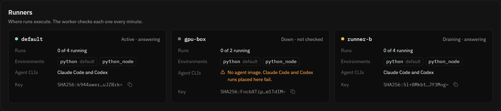

# Runners

[README](../README.md) · [Deploy](production-deployment.md) · [Sandbox and compute](sandbox.md) · [Architecture](architecture.md#where-things-run)

The control plane holds the credentials and decides what runs. A **runner**
owns Docker on its host and starts every container a run needs: the command
sandbox, setup containers and, for Claude Code and Codex, the agent container.
`secondshift up` and the Compose deployment each start one. Add more to spread
runs across hosts, or to offer environments only one host has, such as a
larger machine.

A repository never picks a runner, an image or a Docker flag. It names an
environment, and the control plane sends the run to a runner that offers it.



## Backends

- `fake`: records requests without executing repository code. For tests only.
- `local-docker`: hardened Docker for development and trusted, single-tenant
  self-hosting.
- `isolated-runner`: a separate Linux runner using `runsc` for hosted or
  untrusted workloads.

There is no normal no-sandbox backend. Backends are deployment choices with the
same functional runner contract, not job features. Production settings fail
closed unless the configured isolation policy is available. SecondShift never
accepts agent drivers, runtime flags, images, capabilities, networks or mounts
from a repository manifest.

## Sandbox images

Each sandbox is one image, set by one env var on the runner. Jobs pick one by
name. SecondShift writes these into the runner's `runner.env` when it creates
it:

```bash
SECONDSHIFT_SANDBOX_DEFAULT=python
SECONDSHIFT_SANDBOX_PYTHON=python:3.13-slim@sha256:...
SECONDSHIFT_SANDBOX_PYTHON_NODE=nikolaik/python-nodejs@sha256:...
```

- `SECONDSHIFT_SANDBOX_<NAME>` offers a sandbox called `<name>`, the end of
  the env var in lowercase. A job picks it with `environment: <name>` in
  `.secondshift.yaml`.
- `SECONDSHIFT_SANDBOX_DEFAULT` names the sandbox for jobs that name none. To
  run them all with Node, set it to `python_node`.
- `python` is Docker's official `python:3.13-slim`. `python_node` adds Node 24,
  git and make, for jobs that run a project's full checks. It is about 1.5 GB.
  Remove its line to stop offering it.

Where the file is:

- `secondshift up` writes `runner.env` in its data folder, `~/.secondshift` by
  default. A `runner.env` from an earlier release gets the defaults once.
- On a server, `python -m secondshift.config.container_env` writes
  `deploy/production/runner.env`.

The defaults are listed in
[`secondshift/config/runner_images.env`](https://github.com/piotrekno1/second-shift/blob/main/secondshift/config/runner_images.env).
Once written, the file is yours: a new release never changes it. The release
notes say when the defaults change. Restart the runner after a change.

You can add your own image, for example one built `FROM python:3.13-slim` with
Go added. Repositories can never choose an image, only a name the runner
offers. An image must:

- provide `sleep`, `find`, `cat` and `grep` (any Debian or Alpine base does)
- work as an unprivileged user with a read-only root filesystem, no network,
  `HOME=/tmp` and the repository mounted at `/workspace`
- contain no credentials, Docker client or SecondShift code.

Rules the runner checks when it starts:

- A name has letters, digits and underscores, and starts with a letter.
- `SECONDSHIFT_SANDBOX_DEFAULT` must name one of the sandboxes.
- A server refuses an image that is not pinned by digest. `secondshift up` on
  one machine also accepts tags.
- The runner pulls every image when it starts, and refuses to run any other
  image.
- Only the runner knows the images. The worker asks each runner which
  environments it offers once a minute, the web app reads that, and a run
  sends just the name. With several runners, a job's environment needs to be
  offered by only one of them, and its runs go there.
- Every job may use every environment. Vet an image before you add it.
- The settings page shows the default and lists every sandbox with its image
  and env var. When runners offer different sandboxes, it lists each runner's.

The runner checks out the commit itself, so the image needs no git to run
skills. The workspace holds a git repository with one commit of those files and
no earlier history. The default image has no git, so add it to a custom image
if skills run `git status` or `git diff`. Pin custom images by digest
(`name@sha256:…`) so a pushed tag can't change what runs.

Each sandbox's memory, CPU, process and per-command time limits are set on the
runner too. See [Sandbox and compute](sandbox.md#server-settings) and the
[runner variables](environment-variables.md#runner-and-sandboxes).

## Setup commands

Jobs can install their dependencies with
[setup commands](repository-configuration.md#setup-commands) before the agent
starts. Each one runs in its own container with the job's image and the same
sandbox flags. It joins an internal network whose only way out is a second
egress proxy, which allows package registries only. The agent's sandbox stays
offline.

- `secondshift up` on one machine allows setup. The runner starts the proxy
  from the agent image, so setup needs the agent image too.
- A server allows setup only when the runner has
  `SECONDSHIFT_RUNNER_SETUP_PROXY_ADDRESS`. With Compose, uncomment
  `COMPOSE_PROFILES=setup` and `SETUP_PROXY_ADDRESS` in `compose.env`. See the
  [production guide](production-deployment.md#setup-commands).
- The proxy allows `pypi.org`, `files.pythonhosted.org`, `registry.npmjs.org`
  and `registry.yarnpkg.com`. Add a private index with another
  `--allow-host=<host>` in the proxy's command.
- The proxy closes a connection that sends nothing for 60 seconds. A stalled
  download then fails fast and the package manager retries it, instead of
  using up the setup time limit. Change it with `--idle-seconds=<seconds>`.
- Every job may run setup once the server allows it. A registry accepts
  uploads as well as downloads, so a setup command could publish repository
  content. Only people who can merge to a repository choose its commands.

## Manage runners

The runner in the [Compose deployment](production-deployment.md) is registered
as `default`, from `SECONDSHIFT_RUNNER_SERVICE_URL` and its token. Manage
runners from the web container. `dc` is the Compose shortcut from
[Deploy](production-deployment.md#prepare):

```bash
dc exec web python manage.py runners list
dc exec web python manage.py runners drain default     # finish its runs, take no new ones
dc exec web python manage.py runners activate default
```

`list` shows each runner's state, whether it answers, its pool, session limit,
environments, whether it can run Claude Code and Codex, the fingerprint of its provisioning key and its address. Tokens
are never shown.

Staff see the same on the dashboard's Settings page, under Runners, without
addresses. When there are several runners, a run's details name the one it ran
on.

## How runs are placed

Runs go to active runners in the `default` pool. A run goes to a runner that
offers its environment and has a session free, preferring the one with the most
free sessions. When every runner that could take it is full or draining, it
waits. A subscription login stays on the runner it first ran on, since Codex
keeps its refreshed tokens there, and moves only when that runner drains,
stops answering or lacks the environment.

The worker runs at most `SECONDSHIFT_RUN_CONCURRENCY` runs at once, two by
default, whatever the runners can take. When you add a runner, raise it in
`worker.env` to the sessions you want in use across all runners, and restart
the worker.

## Health

The worker checks each runner every minute:

- After two minutes without an answer, a runner takes no new runs.
- After ten, its runs fail with the reason that the runner stopped answering.
  When it answers again, it is told to stop their sessions.
- Draining and activating are your choice. A drained runner that comes back
  stays drained.

## Add a runner

A runner on another host needs Docker and gVisor, like the control plane host. It runs
`compose.runner.yaml`: the runner, its own PostgreSQL, the agents' egress
proxy and Caddy, which serves the runner over HTTPS. The control plane is its
only client. Its agents can't reach the control plane's gateway, so they send their
tool calls to their runner, and the worker collects and answers them.

On the runner host, with a checkout of the same release, copy the template and
set `RUNNER_DOMAIN` to the runner's hostname, `RUNNER_DATABASE_PASSWORD`
and `RUNNER_ROOT`. Its DNS must point at the host, and ports 80 and 443 must be
open for Caddy's certificate. Then generate its `runner.env`:

```bash
cp deploy/runner/compose.env.example deploy/runner/compose.env
rc() { docker compose --env-file deploy/runner/compose.env -f compose.runner.yaml "$@"; }
image=$(sed -n 's/^SECONDSHIFT_IMAGE=//p' deploy/runner/compose.env)
docker run --rm --user "$(id -u):$(id -g)" \
  -v "$PWD/deploy/runner:$PWD/deploy/runner" \
  -w "$PWD/deploy/runner" "$image" \
  python -m secondshift.config.container_env --runner --hostname runner-b.example.com
```

`runner.env` starts with the default sandbox images. Give it the same ones as
the control plane host's `runner.env`. If workspaces use Claude
Code or Codex, build the agent image there with the command in
[optional subscription agents](production-deployment.md#optional-subscription-agents), using `rc` for
`dc`, and set `AGENT_IMAGE` in that host's `compose.env`. Create `RUNNER_ROOT`
and start it:

```bash
rc up -d --wait postgres
rc run --rm --no-deps runner python manage.py migrate --noinput \
  --settings=secondshift.config.settings.runner
rc up -d --wait
```

Back on the control plane host, register it. Take the token from
`SECONDSHIFT_RUNNER_SERVICE_TOKEN` in the runner's `runner.env`. `add` asks for
it, so it stays out of shell history:

```bash
dc exec web python manage.py runners add runner-b \
  https://runner-b.example.com --max-sessions 4
```

Subscriptions are on when the control plane host's `compose.env` sets `AGENT_IMAGE`. Each
runner then runs the agent image its own configuration names. Every runner
that takes subscription runs needs one, since placement doesn't check yet. A
runner without it refuses their runs. `runners add` warns about a runner
without it, and `runners list` shows `agents=no` for it.

The agents on that host reach the internet and their runner only through its
egress proxy, as on the first host. The relay takes only a running agent's own
token, and the runner API is never served on its port.

Use `--allow-http` only on a private network you trust, such as WireGuard: the
token, repository files and run output cross it unencrypted. Each runner must
have a token no other runner has, so one that is taken over can't call the
others.

`add` asks the runner for its environments and pins the public key that
subscription logins are sealed to, and prints its fingerprint. Compare it with
the runner's own:

```bash
dc exec runner python manage.py runner_key --settings=secondshift.config.settings.runner
```

On another host, run the same with `rc` in place of `dc`.

From then on, logins are sealed only to that key. A runner that answers with
another key gets no login.

## Remove a runner

Drain it and wait until `list` shows it has no runs, then:

```bash
dc exec web python manage.py runners remove runner-b
```

`remove` first asks the runner to delete every subscription login it may hold.
If it can't confirm, the runner stays registered. `--force` removes it anyway,
and then delete its `agent-auth` directory and its backups on that host.

## When a runner's key changes

A runner keeps its key in `agent-auth/provisioning-key.pem` in its runner
directory. The [backup](production-deployment.md#update-and-back-up) keeps it in `runner.tgz`. A runner whose directory
was lost or restored without that archive makes a new key, and it gets no
logins until you pin the new one:

```bash
dc exec web python manage.py runners trust-key default
```

Run it only when you know why the key changed. Otherwise check the runner's
address first: logins would go to whatever answers there.
