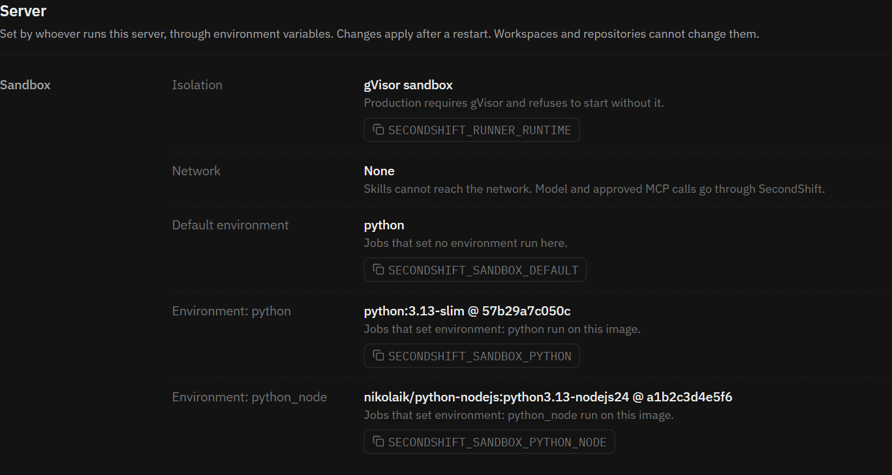

# Sandbox and compute

[README](../README.md) · [Control](control.md) · [Runners](runners.md) · [Security model](security-model.md#what-a-run-can-reach)

A run reaches three things: a sandbox for its commands, the model through the
gateway, and approved tools through the broker. The sandbox and the compute
behind it are set by the server operator. Workspaces and repositories cannot
change them. Everyone in a workspace can see the current settings under
**Settings → Server**.

## The command sandbox

Each run gets a fresh container holding a copy of the repository at the run's
commit. Every command the agent runs, such as a test or a `grep`, runs inside
it. The container has:

- **no network**, started with `--network=none`,
- **no credentials**, not even the model key,
- a **read-only root filesystem**, with the repository at `/workspace`,
- **all Linux capabilities dropped**, no privilege escalation, and an
  unprivileged user,
- **capped memory, CPU and processes**: 2 GB, 2 CPUs and 1,024 processes by
  default.

Production requires gVisor (`runsc`), which gives each sandbox its own kernel,
and refuses to start without it. Plain Docker is for a trial on your own
machine.

When the agent finishes, the runner stops the container. It keeps the files
the agent saved in `/outputs` and, for jobs that publish changes, a patch of
the agent's edits. The patch is computed against a record of the commit kept
outside the sandbox, so the agent cannot tamper with it.

Each command has its own time limit, 5 minutes by default. A command past it
ends inside the sandbox and the agent can carry on. Under gVisor, a sandbox
that runs out of memory ends, and the run fails.

## Environments

A job runs in the server's default image unless it names another with
`environment:` in `.secondshift.yaml`. It can only pick a name the server
offers, never an image. Images are pinned by digest, so a pushed tag can't
change what runs. The defaults are `python`, Python 3.13, and `python_node`,
which adds Node 24, git and make for jobs that run a project's full checks.

To offer other tools, the operator adds an image. See
[sandboxes](runners.md#sandbox-images).

## Installing dependencies

A job's [setup commands](repository-configuration.md#setup-commands) run
before the agent starts, only if the server allows them. Each runs in its own
container with the same flags, on a network whose only way out is a proxy for
package registries: PyPI and npm by default. No model output or tool result has
entered the run yet. The agent's first command closes setup for good, and the
agent's own sandbox stays offline.

## Subscription agents

Claude Code and Codex run in a separate agent container. Through an egress
proxy, it reaches only the provider's API and sign-in hosts. The CLI's own
shell, file and web tools are off: its commands go to the command sandbox and
its tool calls to the broker. See [isolation](agent-subscriptions.md#isolation).

## Compute

- The worker runs at most `SECONDSHIFT_RUN_CONCURRENCY` runs at once, 2 by
  default. Others wait in the queue.
- A server can use several [runners](runners.md#how-runs-are-placed), each on
  its own host. A run goes to a runner that offers its environment and has a
  free session.
- One-off tasks run one at a time per repository, and a schedule skips a tick
  while the job still has a run going.

## Server settings

| Variable | Default | Sets |
| --- | --- | --- |
| `SECONDSHIFT_RUNNER_RUNTIME` | `runsc` | The OCI runtime for every sandbox. `docker` only on one machine |
| `SECONDSHIFT_RUNNER_MEMORY` | `2g` | Memory per sandbox, with no extra swap |
| `SECONDSHIFT_RUNNER_CPUS` | `2` | CPUs per sandbox |
| `SECONDSHIFT_RUNNER_PIDS_LIMIT` | `1024` | Processes per sandbox |
| `SECONDSHIFT_RUNNER_COMMAND_TIMEOUT_SECONDS` | `300` | Time limit for each command |
| `SECONDSHIFT_SANDBOX_<NAME>` | `python`, `python_node` | An image jobs can choose by name |
| `SECONDSHIFT_SANDBOX_DEFAULT` | `python` | The image for jobs that name none |
| `SECONDSHIFT_RUNNER_SETUP_PROXY_ADDRESS` | Unset | Allows setup commands |
| `SECONDSHIFT_RUN_CONCURRENCY` | `2` | Runs at once per worker |

[Configure](server-configuration.md) explains each one, and
[Environment variables](environment-variables.md#runner-and-sandboxes) lists every runner setting.
