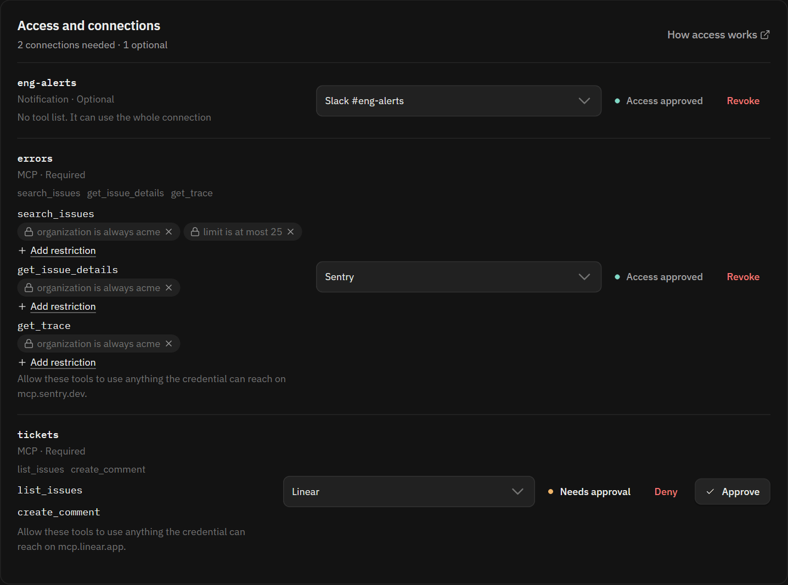
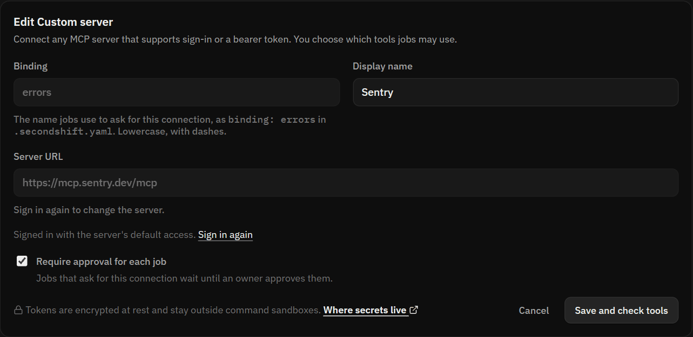
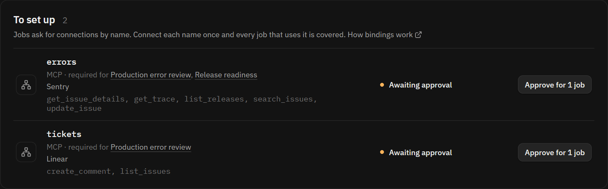

# Services

[README](../README.md) · [Control](control.md) · [Connections](connections.md) · [Security model](security-model.md#who-grants-what)

A run calls outside services only through tools a workspace owner approved,
with the arguments the owner allows. Adding the services is covered in
[Connections](connections.md).



A run can call a tool only when all of these hold:

1. The job's committed `.secondshift.yaml` asks for it.
2. An owner allowed the tool on the connection.
3. An owner approved the job's request, or the connection doesn't require
   approval.
4. The tool was in the run's plan when the run started.

Each call then passes these layers, from the widest to the narrowest:

| Layer | Set by | What it limits |
| --- | --- | --- |
| Credential | Owner, when connecting | Everything the service lets the token do |
| Allowed tools | Owner, on the connection | Which tools any job may use |
| Job approval | Owner, when the connection requires it | Which of those tools this job gets |
| Argument restrictions | Owner, in the job's access review | Which argument values this job may send |
| Built-in scoping | SecondShift, for GitHub and Sentry | The job's repository, or the chosen Sentry organization |
| Broker checks | SecondShift, on every call | The run's frozen plan, the grant, and the tool's input schema |

## Credential

The credential sets the reach. Choosing fewer tools does not narrow what the
token itself can do, so use the narrowest one the service offers and a
read-only server URL where there is one. Sign in as an account that sees only
what jobs should see.

When a connection uses OAuth, SecondShift refuses the sign-in if the server
grants fewer scopes than you ticked. If it grants more, the connection shows
**Broader access than requested** with the extra scopes. See
[connect any MCP server](connections.md#connect-any-mcp-server).

The credential is encrypted in the database and decrypted only inside the
broker call. The agent and the sandbox never see it.

## Allowed tools

After connecting, the owner chooses which of the service's tools any job may
use. Tools the server marks read-only start selected, and so do GET operations
of an HTTP API. **May change data** marks a tool the server did not mark
read-only. GitHub and Sentry offer only read tools.

## Require approval for each job

Each MCP and API connection has **Require approval for each job**. It is off
for new connections. With it off, a job that asks only for allowed tools is
ready once its manifest syncs, so merging the change is the review. With it on,
every job that asks for the connection waits for an owner, and so does any
change to what it asks for.

Turn it on for connections whose tools change data, or when people who can
merge shouldn't decide access on their own. Find it under **Connections**, in
the connection's **Edit** form.



Requests that wait for an owner are listed at the top of **Connections**, and
the sidebar shows how many jobs are waiting.



Turning approval back on keeps existing grants, and new or changed requests
wait again. An owner's denial is never overridden. Teams that leave approval
off and want a specific reviewer can require one with a `CODEOWNERS` entry for
`.secondshift.yaml`:

```text
/.secondshift.yaml @your-org/platform-owners
```

## Review a job's access

The job page lists each connection the job asks for and the tools it wants.
An owner picks the connection, then approves or denies, as in the screenshot
at the top of this page. **Revoke** takes access away, and a run in progress
fails at its next call to that service.

## Restrict arguments

Under each approved tool, **Add restriction** narrows one top-level argument
from the tool's input schema:

| Rule | Effect |
| --- | --- |
| Always this value | The broker always sends this value. The model does not see the argument. |
| Only these values | The model must send one of these values. |
| At most | The model must send a number no larger than this. |
| Never sent | The model may not send the argument. Not offered for arguments the tool requires. |

Use restrictions for arguments that pick a target. A digest job allowed to use
Slack's `post_message` can be limited to the `#alerts` and `#ops` channels. A
Sentry search can be fixed to one organization and capped at 25 results.

- Restrictions belong to one job's grant. Other jobs on the same connection are
  not affected.
- For an HTTP API, the arguments are the path and query parameters, and the
  request body as a whole.
- The model sees the tool's schema with the restrictions applied. The broker
  enforces them. A call that breaks one never reaches the service, and the run
  fails with a **Tool restriction** error that names the argument, never the
  value.
- Built-in scoping still applies afterwards, so a restriction cannot widen it.
- If the service changes a tool's schema and a restriction no longer fits, the
  job is blocked until the owner updates the restriction.
- `.secondshift.yaml` cannot set or change restrictions.

## What stays open

An approved tool can still be misused within its restrictions, for example by
a prompt injection in a tool result or a trigger payload. Approve read-only
tools where you can, and read the [remaining risks](security-model.md#remaining-risks).
