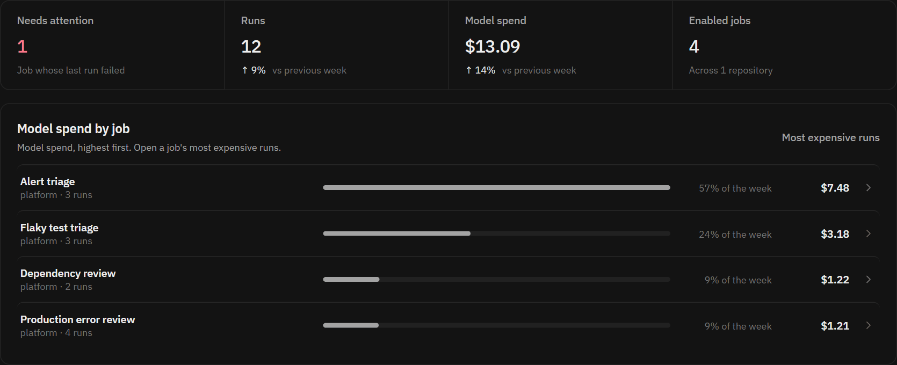
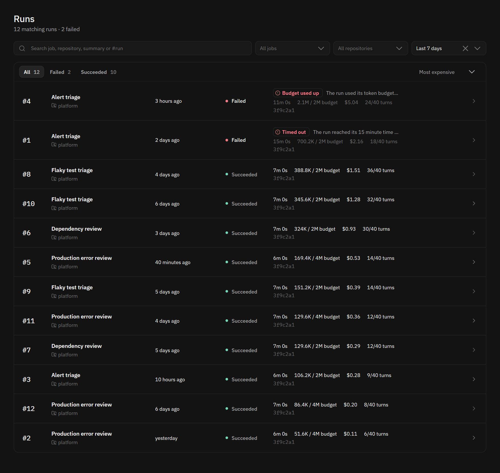
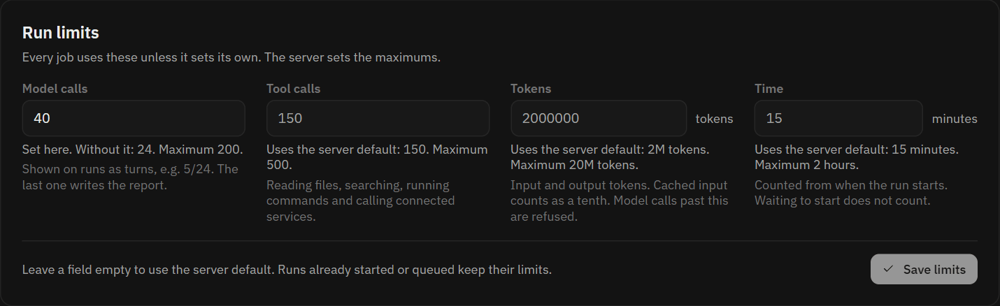
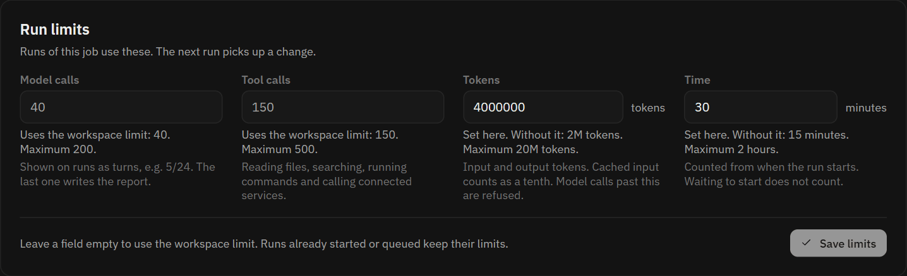
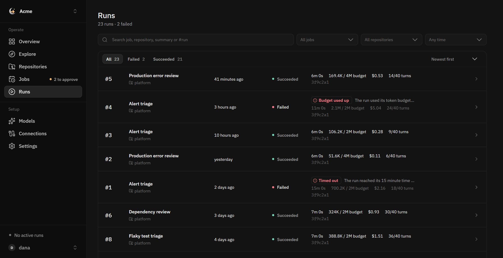
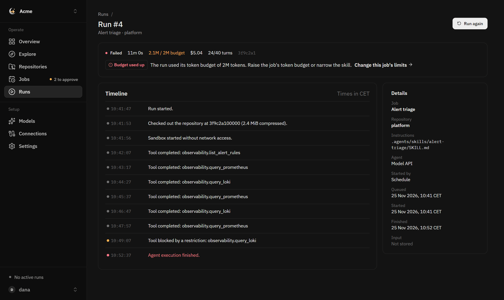
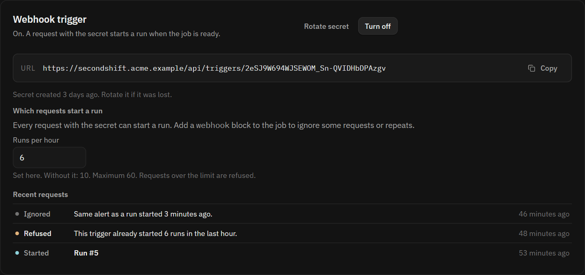

# Spend

[README](../README.md) · [Control](control.md) · [Models](models.md) · [Configure](server-configuration.md)

Every run has limits on model calls, tool calls, tokens and time. Triggers,
subscription logins and the worker also cap how many runs start.

## See what you spend

The Overview shows the last seven days of model spend against the seven days
before, and which jobs it went to.

Each job links to its most expensive runs. **Most expensive runs** opens
**Runs** for the last seven days, sorted by cost, where you can see whether
the costly runs came close to their limits.

Only runs on an API key have a cost. Subscription runs report tokens, and a
total that leaves some runs out is marked as partial.

## Run limits

| Limit | Counts | Default | Server maximum |
| --- | --- | --- | --- |
| Model calls | Requests to the model. The last one writes the report. | 24 | 200 |
| Tool calls | File reads, searches, commands and calls to connected services | 150 | 500 |
| Tokens | Input and output tokens. Cached input counts as a tenth. | 2,000,000 | 20,000,000 |
| Time | From when the run starts. Time in the queue doesn't count. | 15 minutes | 2 hours |

Owners and admins set limits for the whole workspace on **Settings**. Leave a
field empty to use the server default.

Override them for one job at the bottom of its page. A job's limit wins over
the workspace's, and the workspace's over the server default. Nothing can go
above the server maximum. `.secondshift.yaml` cannot set limits.

A run's limits are frozen when it is created. Changing one affects the next
run, not one that is queued or running. Each run's prompt states its limits, so
the agent can size its work.

### When a run reaches a limit

When the agent is down to its last model call or out of tool calls, its tools
are taken away and it writes the report with what it has. That run succeeds,
and its timeline notes that the budget ran out. A run that still goes past a
limit, or uses its whole token budget, fails as **Budget used up**. A run past
its time limit fails as **Timed out**. Both keep what the agent wrote so far as
a partial report.

The runs list shows each run's usage against its limits, and the cost of runs
on an API key.

A failed run names the limit and links to the job's limits. Hover over the
token count to see every token as the provider reported it.

## Webhook triggers

A webhook trigger starts runs for anyone who holds its secret, so each trigger
has a cap on runs per hour, 10 by default. Owners and admins set it on the job
page, up to the server maximum. Requests over the cap are refused and listed
under **Recent requests**.

Turn a trigger off, or rotate its secret, if the secret may have leaked.
Schedules can't pile up: a tick is skipped while the job still has a run going.

## Models and subscriptions

- **Allowed models.** A model provider on [Models](models.md) can list the
  models runs may call. The gateway refuses any other model.
- **Subscription logins.** A Claude Code or Codex login can cap how many runs
  use it in a rolling 24 hours. See [subscription limits](agent-subscriptions.md#limits).
  Codex reports tokens only when it finishes, so use an API key when you need
  a strict token cap.

## What is not capped

Limits apply to each run. SecondShift has no workspace-wide token or dollar
budget per day or month. Total spend is bounded by each run's limits, each
trigger's runs per hour, the job schedules, each subscription login's daily
cap, and how many runs the server runs at once.

The Overview reports spend but doesn't stop it, so set a spending limit with
your model provider as well.

## Server limits

The server operator sets each limit's default and maximum with environment
variables. Owners choose values up to the maximum.

- **Time**: `SECONDSHIFT_RUN_TIMEOUT_SECONDS`, default 900 seconds, maximum
  7,200.
- **Model calls**: `SECONDSHIFT_AGENT_MAX_TURNS`, default 24, maximum 200.
- **Tool calls**: `SECONDSHIFT_AGENT_MAX_TOOL_CALLS`, default 150, maximum 500.
- **Tokens**: `SECONDSHIFT_MODEL_RUN_TOKEN_BUDGET`, default 2,000,000, maximum
  20,000,000.
- **Webhook runs per hour**: `SECONDSHIFT_TRIGGER_MAX_RUNS_PER_HOUR`, default
  10, maximum 60.

Set a maximum with the same variable plus `_CEILING`, for example
`SECONDSHIFT_AGENT_MAX_TURNS_CEILING`. A maximum is never below its default.
The defaults suit short reviews. The maximums leave room for long jobs, such as an audit, so an owner can raise one
job's limits without a server change. Lower a maximum to stop owners from
choosing long runs. Lowering it later also caps values owners already chose.

`SECONDSHIFT_RUN_CONCURRENCY` caps how many runs each worker runs at once, 2 by
default. Runs past it wait in the queue. The worker's other settings are under
[background work](environment-variables.md#background-work-and-internal-services).
